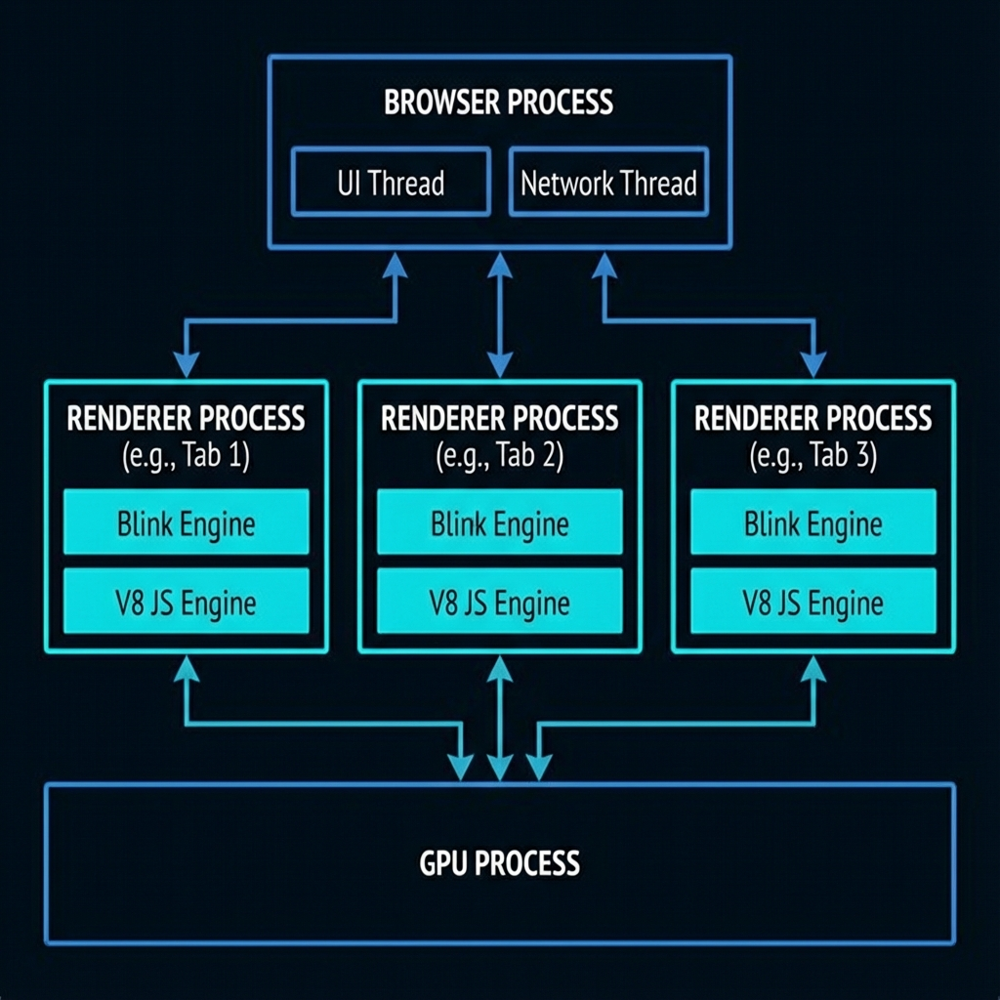
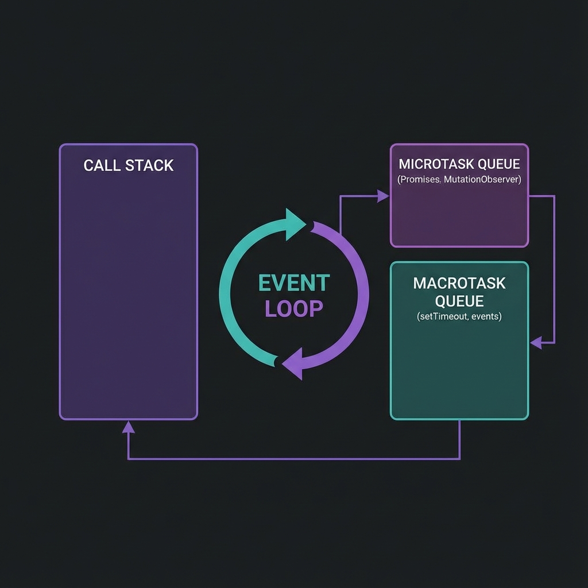
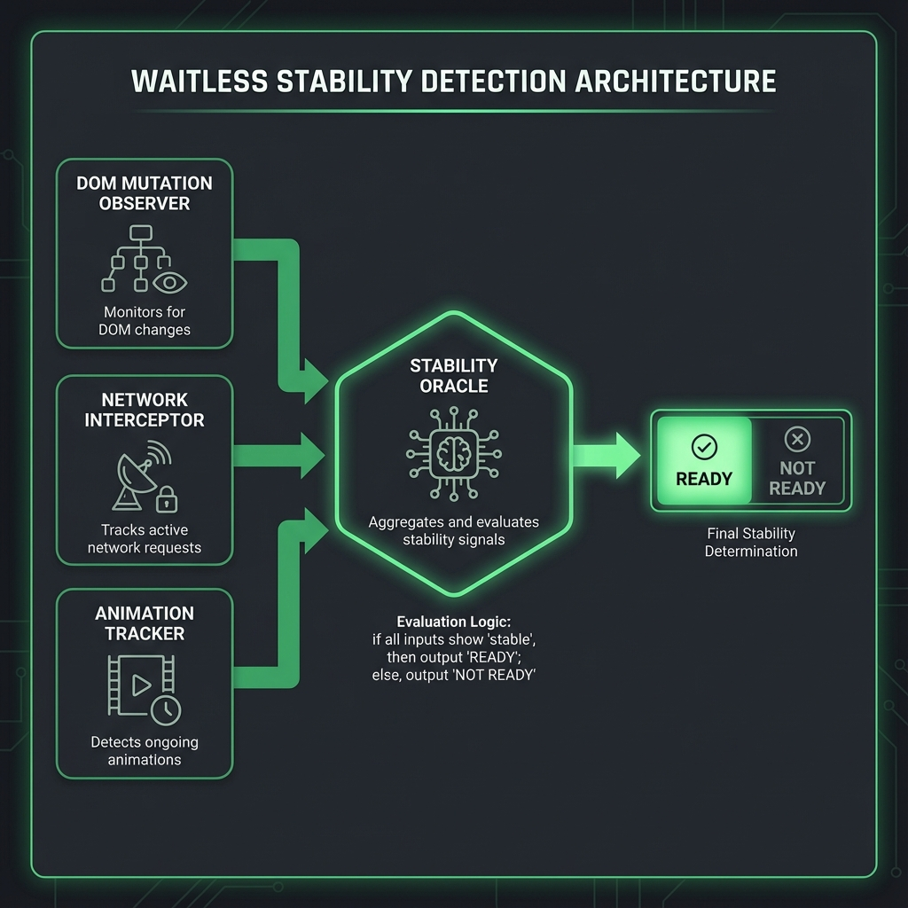
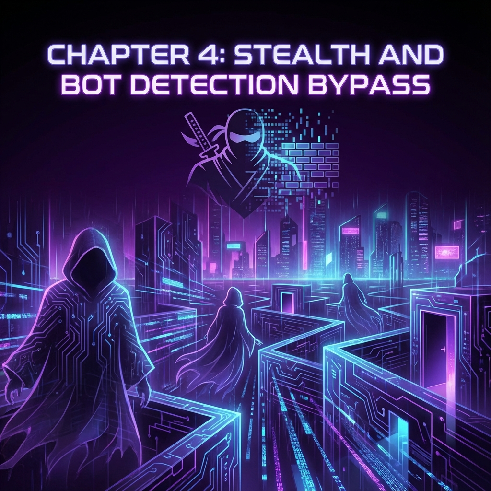
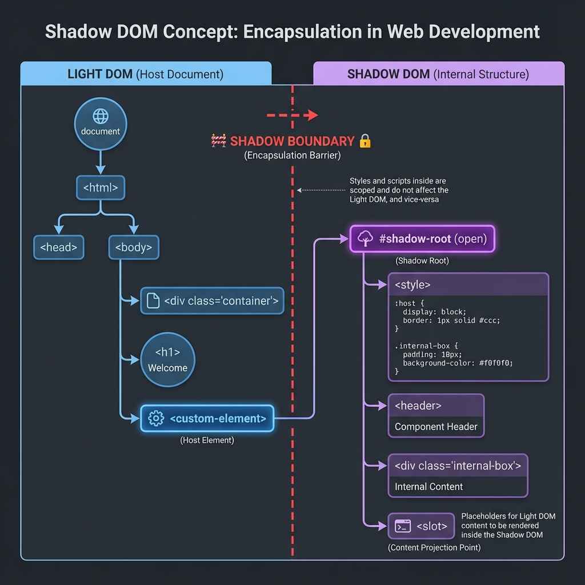

<!-- Generated from book_final.html by scripts/generate-book-markdown.mjs. Edit the HTML source. -->

# The Automation Architect's Playbook

## A Comprehensive Guide to Building Enterprise-Grade Test Automation

### Mastering the Internals: From Browser Fundamentals to AI-Powered Testing

---

*This book represents years of practical experience solving real automation challenges. The tools, patterns, and approaches described have been deployed and refined through countless iterations.*


---

# Preface

## Who this book is for

This playbook is for engineers moving from individual test scripts to dependable automation systems. You should be comfortable reading Python and basic HTML. If you are new to browser automation, start with the setup guide and Chapters 1–2; if you own a framework, begin with Chapters 17–18.

The central question is simple: **what evidence would convince you that the system did the right thing?** A green test, a quiet network, or a confident model response is only a signal. Good architecture connects those signals to an observable outcome.

## Read around a problem

| Your problem | Read next | Leave with |
| --- | --- | --- |
| Tests pass locally and fail in CI | Chapters 1–3, then 18 | A failure classification and a reproducible waiting condition |
| UI changes keep breaking the suite | Chapters 4, 9–11, and 15 | Locator contracts and assertions that detect meaningful regressions |
| Your framework is expensive to maintain | Chapters 5–6 and 17–20 | A layering decision, isolated test data, and a measured execution budget |
| You are adding AI or autonomous tools | Chapters 12–13 and 23–25 | Separate integration tests, model evaluations, and agent execution checks |

## How to use the examples

Each chapter starts with an outcome and a practical checkpoint. Code fragments explain a technique; they are not a complete application or a promise of compatibility with every package version. Supply your own fixtures, URLs, credentials, and teardown. Check the linked project documentation, pin the versions you validate, and run examples in a disposable test environment.

The tools illustrate design decisions. Compare their behavior with the standard capabilities of your test framework before adding another dependency. Chapters 24–25 describe proposed architectures, with explicit limits and validation criteria.

## Three principles

1. **Make outcomes observable.** Define the assertion before choosing the wait or the tool.
2. **Keep failures explainable.** Capture the first failure, inputs, versions, and relevant artifacts before retrying.
3. **Measure the tradeoff.** Track runtime, false positives, maintenance effort, and missed regressions on your own suite.

# Prerequisites & Setup Guide

## A reproducible starting point

Use a supported Python version compatible with the tools you choose, a current browser, Git, and an isolated virtual environment. For JavaScript examples, choose a supported Node.js LTS release from the [official release schedule](https://nodejs.org/en/about/previous-releases).

```bash
python --version
python -m venv .venv
# Activate on macOS / Linux:
source .venv/bin/activate
# Or in Windows PowerShell:
# .venv\Scripts\Activate.ps1
python -m pip install --upgrade pip
python -m pip install selenium pytest requests
python -m pip freeze > requirements.lock.txt
```

Commit the dependency lock after validating your environment. Record the browser and operating-system versions alongside test artifacts so local and CI failures can be compared.

## Browser drivers

[Selenium Manager](https://www.selenium.dev/documentation/selenium_manager/) is included in modern Selenium releases and resolves drivers when none is supplied. Restricted networks and offline CI may need pre-provisioned browser and driver binaries.

## Your first reproducible test

Save this as `test_smoke.py` and run `python -m pytest -q`. It uses an in-memory page, so it does not depend on an external application.

```python
from urllib.parse import quote
from selenium import webdriver
from selenium.webdriver.common.by import By

def test_browser_smoke():
    driver = webdriver.Chrome()
    try:
        html = "<title>Playbook lab</title><h1>Ready</h1>"
        driver.get("data:text/html;charset=utf-8," + quote(html))
        assert driver.title == "Playbook lab"
        assert driver.find_element(By.TAG_NAME, "h1").text == "Ready"
    finally:
        driver.quit()
```

## Choose a waiting contract

Wait for the outcome relevant to your test. Page loading does not guarantee that application state is ready, and mixing implicit and explicit Selenium waits can make timeout behavior unpredictable. See [Selenium waiting strategies](https://www.selenium.dev/documentation/webdriver/waits/) and [Playwright actionability checks](https://playwright.dev/docs/actionability). An actionable click still needs a business-result assertion.

# PART I: FOUNDATIONS

## Understanding the Platform Before Building On It

> *"You cannot truly master a tool until you understand the substrate it operates on."*

Before writing a single line of automation code, you need to understand what's actually happening inside the browser. This knowledge separates automation engineers who can debug any problem from those who copy-paste Stack Overflow answers and hope for the best.

---

# Chapter 1: How Browsers Actually Work

**What you’ll learn** Trace a user action through browser execution and rendering.

**Put it to work** Replace one page-load assumption with an assertion about the resulting application state.

## Why This Chapter Matters

Many browser automation failures become easier to diagnose when you understand rendering, events, and element lifecycles. Other failures come from test data, services, infrastructure, or the test itself.

- `ElementNotInteractableException` — The browser says the element isn't ready 
- `StaleElementReferenceException` — The DOM changed while you were looking at it 
- `TimeoutException` — Something took longer than expected 
- Element found but click doesn't work — Event handlers aren't attached yet

Understanding browser internals transforms these from "random failures" into **predictable, fixable problems**.

---

## The Browser's Multi-Process Architecture

Modern browsers like Chrome are not a single program—they're a **collection of processes** working together. This architecture was designed for security and stability, but it has profound implications for automation.



### The Process Model

```
┌─────────────────────────────────────────────────────────────────────┐
│                        BROWSER PROCESS                               │
│  • UI (tabs, address bar, bookmarks)                                │
│  • Network requests                                                  │
│  • Storage management                                                │
│  • Inter-Process Communication (IPC) hub                            │
└────────────┬─────────────────────────────────────────┬──────────────┘
             │                                         │
             ▼                                         ▼
┌────────────────────────────┐          ┌────────────────────────────┐
│     RENDERER PROCESS #1    │          │     RENDERER PROCESS #2    │
│     (Tab 1: example.com)   │          │     (Tab 2: google.com)    │
│  ┌──────────────────────┐  │          │  ┌──────────────────────┐  │
│  │    Blink Engine      │  │          │  │    Blink Engine      │  │
│  │  • HTML Parser       │  │          │  │  • HTML Parser       │  │
│  │  • CSS Engine        │  │          │  │  • CSS Engine        │  │
│  │  • Layout Engine     │  │          │  │  • Layout Engine     │  │
│  └──────────────────────┘  │          │  └──────────────────────┘  │
│  ┌──────────────────────┐  │          │  ┌──────────────────────┐  │
│  │    V8 JavaScript     │  │          │  │    V8 JavaScript     │  │
│  │    Engine            │  │          │  │    Engine            │  │
│  └──────────────────────┘  │          │  └──────────────────────┘  │
    🔍 Deep Dive: V8 Bindings & The DOM Bridge
    JavaScript doesn't "own" the DOM. The DOM lives in the C++ core of the browser engine (Blink). When you call
        document.getElementById(), you're crossing a "bridge" from the JavaScript world (V8) to the C++
        world. This context switching is expensive. In high-frequency automation, hundreds of these crossings occur
        every second, creating a performance bottleneck that can look like network latency.
└────────────────────────────┘          └────────────────────────────┘
             │
             ▼
┌────────────────────────────┐
│       GPU PROCESS          │
│  • Compositing layers      │
│  • WebGL rendering         │
│  • Video decoding          │
└────────────────────────────┘
```

### What This Means for Automation

**Key Insight #1: Each tab is isolated**

When you open a new browser window or tab in Selenium, you're potentially creating a new renderer process. Cookies, localStorage, and JavaScript state are shared per-origin, but memory and execution are isolated.

**Key Insight #2: JavaScript runs in the renderer process**

When you call `driver.execute_script()`, your JavaScript runs in the renderer process—the same place the website's JavaScript runs. This is why you can access `document`, `window`, and the DOM directly.

**Key Insight #3: Network requests go through the browser process**

This is why some bot detection techniques work—they can observe network behavior at the browser level, not just at the page level.

---

## The Rendering Pipeline: From HTML to Pixels

When you navigate to a URL, here's what happens inside the browser:

### Stage 1: Network Fetch

```
URL Entered → DNS Lookup → TCP Connection → TLS Handshake → HTTP Request → Response
```

The browser process handles this. The response (HTML, CSS, JS, images) streams back.

### Stage 2: HTML Parsing and DOM Construction

```html
<!-- This HTML... -->
<html>
  <body>
    <div id="container">
      <button id="submit">Click Me</button>
    </div>
  </body>
</html>
```

```
<!-- ...becomes this DOM tree -->
Document
  └── html
       └── body
            └── div#container
                 └── button#submit
                      └── TextNode: "Click Me"
```

**💡 Key Insight: The DOM is a live tree structure**

When you call `driver.find_element(By.ID, "submit")`, Selenium traverses this tree. If the tree changes (React re-renders, Ajax loads content), your reference might become "stale."

### Stage 3: CSS Parsing and CSSOM Construction

```css
/* This CSS... */
#container {
  display: flex;
}
button {
  background: blue;
  padding: 10px;
}
```

```
/* ...becomes the CSSOM */
StyleSheetList
  └── CSSStyleSheet
       └── #container { display: flex }
       └── button { background: blue; padding: 10px }
```

### Stage 4: The Render Tree

The DOM and CSSOM combine to create the **Render Tree**—only visible elements are included:

```
RenderTree
  └── RenderBody
       └── RenderDiv (display: flex)
            └── RenderButton (background: blue, padding: 10px)
                 └── RenderText: "Click Me"
```

**💡 Key Insight: Elements with `display: none` are NOT in the render tree**

This is why `element.is_displayed()` returns `False` for hidden elements—they literally don't exist in the visual representation.

### Stage 5: Layout (Reflow)

The browser calculates the **exact position and size** of every element:

```
button#submit:
  x: 150px
  y: 200px
  width: 80px
  height: 40px
```

**⚠️ Common Pitfall: Layout is expensive**

Every time the DOM changes, layout might need to recalculate. This is why tests that rapidly modify the DOM can become slow.

### Stage 6: Paint and Composite

Finally, the browser:

1. **Paints** each layer (turns elements into pixels) 
2. **Composites** layers together (stacking order, transparency) 
3. **Sends to GPU** for display

### 🔍 Deep Dive: The Compositor vs. Main Thread

A common automation mystery: *The element is visible, but the click fails.* This often happens because of thread contention. The **Compositor Thread** (which handles scrolling and some animations) is separate from the **Main Thread** (which handles JS and Layout). If the Main Thread is blocked by a long-running script, the browser can still *scroll* (compositor), but it cannot *process a click* (main thread). Automation stability requires the Main Thread to be "idle."

---

## The JavaScript Event Loop

This is **the most important concept** for understanding flaky tests.



### The Single-Threaded Nature of JavaScript

JavaScript in the browser runs on a **single thread**. There's no true parallelism—everything happens one step at a time. But it doesn't *feel* single-threaded because of the **Event Loop**.

```
┌─────────────────────────────────────────────────────────────────┐
│                         EVENT LOOP                               │
│                                                                  │
│  ┌─────────────────┐    ┌────────────────────────────────────┐  │
│  │   Call Stack    │    │           Task Queues               │  │
│  │                 │    │  ┌──────────────────────────────┐  │  │
│  │  Currently      │◄───│  │ Macrotask Queue              │  │  │
│  │  executing      │    │  │ • setTimeout callbacks       │  │  │
│  │  code           │    │  │ • setInterval callbacks      │  │  │
│  │                 │    │  │ • I/O operations             │  │  │
│  └─────────────────┘    │  │ • UI rendering               │  │  │
│                         │  └──────────────────────────────┘  │  │
│                         │  ┌──────────────────────────────┐  │  │
│                         │  │ Microtask Queue              │  │  │
│                         │  │ • Promise callbacks          │  │  │
│                         │  │ • MutationObserver           │  │  │
│                         │  │ • queueMicrotask()           │  │  │
│                         │  └──────────────────────────────┘  │  │
│                         └────────────────────────────────────┘  │
└─────────────────────────────────────────────────────────────────┘
```

### How the Event Loop Works

1. Execute all code in the **Call Stack** until it's empty 
2. Process all tasks in the **Microtask Queue** (Promises, MutationObserver) 
3. Process ONE task from the **Macrotask Queue** (setTimeout, events) 
4. Render (if needed) 
5. Repeat

### Why This Matters for Automation

```javascript
// Website code
button.addEventListener('click', async () => {
    await fetch('/api/data');  // Network request
    updateUI();  // Updates the DOM
});
```

When your Selenium test clicks the button:

1. Click event fires ✓ 
2. Event handler starts executing ✓ 
3. `fetch()` starts a network request in the background ✓ 
4. **The handler pauses at `await` and returns control immediately** ✓ 
5. Your test continues... 
6. **BUT the DOM hasn't updated yet!**

The rest of the handler (`updateUI()`) only runs after the response arrives, when the awaited Promise resolves and its continuation is queued as a microtask.

This is the #1 cause of flaky tests: **assuming synchronous completion**.

### The Solution: Proper Waiting

```python
# ❌ BAD: Assumes synchronous completion
driver.find_element(By.ID, "button").click()
result = driver.find_element(By.ID, "result").text  # May fail!

# ✅ GOOD: Waits for the expected outcome
driver.find_element(By.ID, "button").click()
WebDriverWait(driver, 10).until(
    EC.text_to_be_present_in_element((By.ID, "result"), "Success")
)
```

---

## Page Load Events: When Is a Page "Ready"?

### The Loading Timeline

```
┌──────────────────────────────────────────────────────────────────┐
│                     PAGE LOADING TIMELINE                         │
├──────────────────────────────────────────────────────────────────┤
│                                                                   │
│  Navigation Start                                                 │
│       │                                                           │
│       ▼                                                           │
│  HTML starts downloading ─────────────────────┐                   │
│       │                                       │                   │
│       ▼                                       ▼                   │
│  HTML fully parsed ◄─── DOMContentLoaded event fires              │
│       │                                                           │
│       ▼                                                           │
│  CSS, JS, Images loading ─────────────────────┐                   │
│       │                                       │                   │
│       ▼                                       ▼                   │
│  All resources loaded ◄───── load event fires                     │
│       │                                                           │
│       ▼                                                           │
│  Lazy resources, AJAX ─────────────────────────────┐              │
│       │                                            │              │
│       ▼                                            ▼              │
│  Fully interactive ◄───── NO STANDARD EVENT!                     │
│                                                                   │
└──────────────────────────────────────────────────────────────────┘
```

### What Each Event Means

| Event | What's Ready | What's NOT Ready |
| --- | --- | --- |
| `DOMContentLoaded` | HTML parsed, DOM built | CSS, images, fonts, external JS |
| `load` | All initial resources | Lazy-loaded content, AJAX data |
| (no event) | Everything | — |

### The Problem for Automation

Selenium's `driver.get(url)` waits for the `load` event by default. But modern single-page applications often:

1. Load a minimal HTML shell (triggers `load`) 
2. Execute JavaScript that fetches data 
3. Render the actual UI

Your test starts after `load`, but the UI you need to interact with hasn't rendered yet!

### Solutions

```python
# Strategy 1: Wait for specific elements
driver.get("https://example.com")
WebDriverWait(driver, 20).until(
    EC.presence_of_element_located((By.ID, "main-content"))
)

# Strategy 2: Wait for network idle (using JavaScript)
driver.get("https://example.com")
driver.execute_script("""
    return new Promise(resolve => {
        if (document.readyState === 'complete') {
            setTimeout(resolve, 500);  // Small buffer for AJAX
        } else {
            window.addEventListener('load', () => setTimeout(resolve, 500));
        }
    });
""")

# Strategy 3: Use Waitless (covered in Chapter 3)
from waitless import stabilize
driver = stabilize(webdriver.Chrome())
driver.get("https://example.com")  # Automatically waits for full stability
```

---

## How WebDriver (Selenium) Talks to the Browser

Understanding this communication protocol helps debug "weird" failures.

### The WebDriver Protocol

```
┌─────────────────┐     HTTP/REST      ┌─────────────────┐
│                 │─────────────────────│                 │
│   Your Test     │   {"using": "id",  │   ChromeDriver  │
│   (Python)      │    "value": "btn"} │   (Executable)  │
│                 │◄────────────────────│                 │
└─────────────────┘   {"value": {...}} └────────┬────────┘
                                                │
                                                │ Chrome DevTools
                                                │ Protocol (CDP)
                                                │
                                        ┌───────▼────────┐
                                        │                │
                                        │     Chrome     │
                                        │    Browser     │
                                        │                │
                                        └────────────────┘
```

### What Happens When You Call find_element()

```python
element = driver.find_element(By.ID, "submit-button")
```

1. **Your code** calls Selenium's Python binding 
2. **Selenium** sends HTTP POST to ChromeDriver: `json POST /session/{sessionId}/element {"using": "css selector", "value": "#submit-button"}` 
3. **ChromeDriver** translates to CDP command 
4. **Chrome** executes `document.querySelector("#submit-button")` 
5. **Chrome** returns element reference to ChromeDriver 
6. **ChromeDriver** returns JSON response: `json {"value": {"element-6066-11e4-a52e-4f735466cecf": "abc123"}}` 
7. **Selenium** wraps this in a `WebElement` object

### Why Elements Become "Stale"

That `"abc123"` is a **reference ID**. If the DOM element is removed and re-added (common in React/Vue/Angular), the old reference ID is invalid—hence `StaleElementReferenceException`.

---

## The Chrome DevTools Protocol (CDP)

Selenium 4 introduced direct CDP access, unlocking powerful capabilities:

```python
# Traditional WebDriver (limited)
driver.get("https://example.com")

# Direct CDP access (powerful)
driver.execute_cdp_cmd("Network.enable", {})
driver.execute_cdp_cmd("Network.setExtraHTTPHeaders", {
    "headers": {"X-Custom-Header": "my-value"}
})

# Listen to network events
driver.execute_cdp_cmd("Network.enable", {})
# Now you can capture all network requests/responses
```

### Key CDP Domains for Testing

| Domain | Capabilities |
| --- | --- |
| `Network` | Intercept requests, mock responses, throttle bandwidth |
| `DOM` | Query/modify DOM, track mutations |
| `Performance` | Collect metrics, trace execution |
| `Console` | Capture console.log output |
| `Emulation` | Spoof device, geolocation, timezone |

---

### 🔍 Deep Dive: The Hidden Latency - Cost of a WebDriver Command

Every Selenium command (e.g., `element.is_displayed()`) is an out-of-process network call. Even on localhost, there is overhead for serialization, network transmission, and deserialization. When you put a `find_element` call inside a tight loop, you're not just waiting for the browser; you're paying a "tax" of 5-10ms per call just for the communication protocol itself. This is why batching interactions in JavaScript (using `execute_script`) is often 10x faster for complex tasks.

---

## 🔧 Hands-On Exercise: Exploring Browser Internals

Let's apply what we've learned:

```python
from selenium import webdriver
from selenium.webdriver.common.by import By
import time

driver = webdriver.Chrome()

# 1. Navigate and observe loading
driver.get("https://example.com")
print(f"Page load complete. Title: {driver.title}")

# 2. Explore the DOM
dom_html = driver.execute_script("return document.documentElement.outerHTML.length")
print(f"Total DOM size: {dom_html} characters")

# 3. Check event loop status
pending_tasks = driver.execute_script("""
    return {
        readyState: document.readyState,
        animationsPending: document.getAnimations().filter(a => a.playState === 'running').length
    }
""")
print(f"Document state: {pending_tasks['readyState']}")
print(f"Running animations: {pending_tasks['animationsPending']}")

# 4. Monitor a mutation
driver.execute_script("""
    window.__mutations = [];
    const observer = new MutationObserver(mutations => {
        mutations.forEach(m => window.__mutations.push(m.type));
    });
    observer.observe(document.body, {childList: true, subtree: true});
""")

# Make a DOM change
driver.execute_script("document.body.innerHTML += '<div>Test</div>'")

mutations = driver.execute_script("return window.__mutations")
print(f"Mutations observed: {mutations}")

driver.quit()
```

**Expected Output:**

```
Page load complete. Title: Example Domain
Total DOM size: 1234 characters
Document state: complete
Running animations: 0
Mutations observed: ['childList']
```

---

## 📋 Chapter 1 Summary

| Concept | Key Takeaway |
| --- | --- |
| Multi-Process Architecture | Each tab runs in isolation; crashes don't affect other tabs |
| Rendering Pipeline | HTML → DOM → CSSOM → Render Tree → Layout → Paint |
| Event Loop | Single-threaded but async; explains why clicks don't wait |
| Page Load Events | `load` event fires before AJAX content is ready |
| WebDriver Protocol | HTTP/JSON commands translated to CDP |
| Stale Elements | DOM changes invalidate element references |

**Coming up next:** Now that you understand the platform, let's explore why tests fail unpredictably—and how to analyze the root cause.

---

# Chapter 2: The Anatomy of a Flaky Test

**What you’ll learn** Classify intermittent failures before changing timeouts.

**Put it to work** Keep the first failure trace and reproduce one race with controlled latency.

## Understanding Why Tests Fail Intermittently

Flaky tests are the silent killers of automation credibility. A test that passes on Monday, fails on Tuesday, and passes again on Wednesday—with zero code changes—destroys trust faster than any bug in production.

### The True Cost of Flakiness

Consider these statistics from real enterprise environments:

| Metric | Impact |
| --- | --- |
| Developer time investigating false failures | 4-6 hours/week per engineer |
| Pipeline re-runs due to flaky tests | 15-25% of all runs |
| Confidence in test results | Drops below 60% |
| Time to detect real bugs | Increases by 40% |

When developers stop trusting test results, they stop looking at them. The automation suite becomes expensive decoration.

### 💡 Key Insight: Flakiness Is a Symptom, Not a Disease

Every flaky test has a **deterministic root cause**. The test isn't "randomly" failing—it's failing because of specific conditions that aren't always present. Your job is to find those conditions.

### 🔍 Deep Dive: The Micro-Stutter - GC and JIT Interference

Sometimes the browser itself stops responding for a few milliseconds. This happens during **Garbage Collection (GC)**—when V8 pauses execution to clean up memory—or **Just-In-Time (JIT) Compilation**. These "micro-stutters" are nearly invisible to humans but can cause a race condition to trigger in automation if the browser pauses exactly when a click is being sent. Stable automation builds in a small buffer for these unavoidable internal pauses.

---

## Root Cause Analysis: The Five Categories of Flakiness

### Category 1: Race Conditions

The browser and test script operate at different speeds. The script says "click the button" before the button is ready.

**Symptoms:**

- `ElementNotInteractableException` 
- `StaleElementReferenceException` 
- Tests pass locally, fail in CI

**Example of the Problem:**

```python
# This code has a race condition
driver.get("https://app.example.com/dashboard")
driver.find_element(By.ID, "submit-btn").click()  # May fail!
```

The page is still loading when the click executes. The element might:

- Not exist in the DOM yet 
- Exist but be covered by a loading overlay 
- Exist but be outside the viewport 
- Exist but have event handlers not yet attached

**🔍 Deep Dive: Why Event Handlers Aren't Attached Immediately**

```html
<button id="submit-btn">Submit</button>
<script>
    // This runs after the button exists in DOM
    document.getElementById('submit-btn').addEventListener('click', handleClick);
</script>
```

The button is in the DOM immediately, but the event listener is only attached when the `<script>` executes. If your test clicks before the script runs, nothing happens!

**Solution Pattern:**

```python
from selenium.webdriver.support.ui import WebDriverWait
from selenium.webdriver.support import expected_conditions as EC

# Wait for element to be clickable (visible + enabled)
wait = WebDriverWait(driver, 10)
button = wait.until(EC.element_to_be_clickable((By.ID, "submit-btn")))
button.click()
```

---

### Category 2: Network Variability

API calls complete at different speeds. A dashboard that loads in 200ms locally might take 2 seconds in CI.

**Symptoms:**

- Tests timeout in CI but pass locally 
- Intermittent failures correlate with time of day 
- Tests fail more often on shared CI infrastructure

**Why CI Is Different:**

| Factor | Local Development | CI Environment |
| --- | --- | --- |
| Network Latency | Near-zero (localhost) | Variable (shared infra) |
| CPU | Dedicated | Shared with other jobs |
| Memory | Abundant | Often limited |
| Browser Startup | Instant (browser cached) | Cold start each time |

**Solution Pattern:**

```python
# ❌ BAD: Fixed timeout too short
wait = WebDriverWait(driver, 3)

# ✅ GOOD: Generous timeout with early exit
wait = WebDriverWait(driver, 30)  # Will return early if condition met
element = wait.until(EC.presence_of_element_located((By.ID, "data-loaded")))
```

---

### Category 3: Animation Interference

CSS transitions and JavaScript animations don't block Selenium. The test clicks where the button *will be*, not where it *is*.

**Example:**

```css
.modal {
    transition: transform 0.3s ease-in-out;
    transform: translateY(-100%);
}
.modal.open {
    transform: translateY(0);
}
```

The modal slides in over 300ms. Selenium doesn't wait for CSS transitions.

**🔍 Deep Dive: How Animations Break Clicks**

1. Test finds element at position (100, 500) - where modal WILL be 
2. Browser reports element as "visible" because `opacity > 0` and `display != none` 
3. Test sends click command to coordinates (100, 500) 
4. Animation is still in progress - element is actually at (100, 350) 
5. Click hits wrong element or nothing

**Solution Pattern:**

```python
from selenium import webdriver
from selenium.common.exceptions import JavascriptException

# Wait for all finite animations to complete
def wait_for_animations(driver, timeout=5):
    driver.execute_script("""
        const deadline = performance.now() + arguments[0] * 1000;
        return new Promise((resolve, reject) => {
            const checkAnimations = () => {
                const running = document.getAnimations().filter(a =>
                    a.playState === 'running' &&
                    // Skip infinite animations such as spinners: they never finish
                    a.effect.getComputedTiming().endTime !== Infinity
                );
                if (running.length === 0) {
                    resolve();
                } else if (performance.now() > deadline) {
                    reject(new Error(running.length + ' animation(s) still running'));
                } else {
                    requestAnimationFrame(checkAnimations);
                }
            };
            checkAnimations();
        });
    """, timeout)

# Usage
driver.find_element(By.CLASS_NAME, "open-modal").click()
wait_for_animations(driver)
modal_button = driver.find_element(By.ID, "modal-confirm")
modal_button.click()
```

---

### Category 4: External Dependencies

- Third-party services (payment gateways, OAuth providers) 
- Shared databases with concurrent test runs 
- Time-dependent logic (tests fail at midnight)

**Solution Patterns:**

```python
# 1. Mock external services
@pytest.fixture
def mock_payment_gateway():
    with responses.RequestsMock() as rsps:
        rsps.add(
            responses.POST,
            "https://api.stripe.com/v1/charges",
            json={"id": "ch_test123", "status": "succeeded"},
            status=200
        )
        yield rsps

# 2. Isolate database
@pytest.fixture
def isolated_db_session():
    # Create unique schema per test
    schema_name = f"test_{uuid.uuid4().hex[:8]}"
    create_schema(schema_name)
    yield schema_name
    drop_schema(schema_name)

# 3. Control time
from freezegun import freeze_time

@freeze_time("2024-06-15 14:30:00")
def test_discount_during_sale_period():
    # Time-sensitive logic now predictable
    assert calculate_discount() == 0.20
```

---

### Category 5: Resource Contention

- Insufficient memory causing slow garbage collection 
- CPU contention on shared CI runners 
- Browser instance limits exceeded

**Symptoms:**

- Failures cluster at certain times (when CI is busy) 
- Memory-related crashes 
- "Chrome not reachable" errors

**Solution Patterns:**

```python
# 1. Request dedicated CI resources
# .github/workflows/test.yml
jobs:
  test:
    runs-on: ubuntu-latest
    timeout-minutes: 30
    env:
      CHROME_ARGS: "--disable-dev-shm-usage --no-sandbox"

# 2. Limit parallel browser instances
# pytest.ini
[pytest]
# Max 4 parallel workers (pytest.ini comments must be on their own line)
addopts = -n 4

# 3. Add resource monitoring
import psutil

def check_system_resources():
    memory = psutil.virtual_memory()
    if memory.percent > 90:
        logging.warning(f"High memory usage: {memory.percent}%")
        # Consider failing fast rather than flaking
```

---

## The Traditional Solutions (And Why They Don't Work)

### Solution 1: time.sleep() - The Worst Fix

```python
driver.get("https://app.example.com/dashboard")
time.sleep(5)  # "This should be enough time"
driver.find_element(By.ID, "submit-btn").click()
```

**Problems:**

- **Too slow**: You wait 5 seconds even when the page loads in 500ms 
- **Still flaky**: Sometimes 5 seconds isn't enough 
- **Compounds**: 100 tests × 3 sleeps each × 5 seconds = **25 minutes wasted**

### Solution 2: Explicit Waits - Better But Incomplete

```python
from selenium.webdriver.support.ui import WebDriverWait
from selenium.webdriver.support import expected_conditions as EC

wait = WebDriverWait(driver, 10)
element = wait.until(
    EC.element_to_be_clickable((By.ID, "submit-btn"))
)
element.click()
```

**Improvements:**

- Returns as soon as condition is met 
- Has a timeout for failure cases 
- More descriptive failures

**Remaining Problems:**

- Doesn't wait for network calls to complete 
- Doesn't wait for animations to finish 
- Doesn't detect JavaScript-driven readiness 
- Requires explicit waits everywhere in code

### Solution 3: Custom Expected Conditions - High Maintenance

```python
class all_animations_complete:
    def __call__(self, driver):
        return driver.execute_script("""
            return document.getAnimations().every(a =>
                a.playState === 'finished' || a.playState === 'idle'
            );
        """)

wait.until(all_animations_complete())
```

**Problems:**

- Must remember to add this everywhere 
- Doesn't handle network calls 
- Complex to maintain across team

---

## The Diagnostic Toolkit

Before jumping to solutions, you need to diagnose the specific cause of flakiness.

### Tool 1: Retry Analysis

Run the flaky test 50+ times and analyze patterns:

```python
# pytest_flaky_tracker.py
import pytest
import json
from datetime import datetime

RESULTS_FILE = "flaky_analysis.json"

@pytest.hookimpl(hookwrapper=True)
def pytest_runtest_makereport(item, call):
    outcome = yield
    report = outcome.get_result()

    if call.when == "call":
        result = {
            "test": item.name,
            "timestamp": datetime.now().isoformat(),
            "passed": report.passed,
            "duration": report.duration,
            "error": str(report.longrepr) if report.failed else None
        }

        # Append to results file
        try:
            with open(RESULTS_FILE, "r") as f:
                data = json.load(f)
        except FileNotFoundError:
            data = []

        data.append(result)

        with open(RESULTS_FILE, "w") as f:
            json.dump(data, f, indent=2)
```

Run analysis:

```bash
for i in {1..50}; do pytest test_flaky.py --tb=short; done
python analyze_flaky.py  # Analyze patterns
```

### Tool 2: Screenshot on Failure

```python
@pytest.fixture
def driver(request):
    driver = webdriver.Chrome()
    yield driver

    # Capture screenshot on failure
    if request.node.rep_call.failed:
        screenshot_dir = Path("screenshots")
        screenshot_dir.mkdir(exist_ok=True)

        filename = f"{request.node.name}_{datetime.now():%Y%m%d_%H%M%S}.png"
        driver.save_screenshot(str(screenshot_dir / filename))

    driver.quit()

@pytest.hookimpl(tryfirst=True, hookwrapper=True)
def pytest_runtest_makereport(item, call):
    outcome = yield
    rep = outcome.get_result()
    setattr(item, f"rep_{rep.when}", rep)
```

### Tool 3: Network Log Capture

```python
# Resource Timing only lists requests that have already finished,
# so it cannot show pending ones. Count them in the page instead.
TRACKER = """
window.__pending_requests = 0;
const originalFetch = window.fetch;
window.fetch = (...args) => {
    window.__pending_requests++;
    return originalFetch(...args).finally(() => window.__pending_requests--);
};
const originalSend = XMLHttpRequest.prototype.send;
XMLHttpRequest.prototype.send = function (...args) {
    window.__pending_requests++;
    this.addEventListener('loadend', () => window.__pending_requests--, { once: true });
    return originalSend.apply(this, args);
};
"""

def enable_network_logging(driver):
    # Chrome only: runs the tracker before the page's own scripts on every load
    driver.execute_cdp_cmd("Page.addScriptToEvaluateOnNewDocument", {"source": TRACKER})

def get_pending_requests(driver):
    return driver.execute_script("return window.__pending_requests || 0")
```

---

## 📋 Chapter 2 Summary

| Flakiness Category | Percentage | Primary Solution |
| --- | --- | --- |
| Race Conditions | 40% | Explicit waits for expected state |
| Network Variability | 25% | Generous timeouts, network mocking |
| Animation Interference | 15% | Wait for `getAnimations()` to settle |
| External Dependencies | 10% | Mock services, isolate data |
| Resource Contention | 10% | Dedicated resources, monitoring |

**The Ultimate Solution:** In the next chapter, we'll introduce **Waitless**, which addresses race conditions, network variability, AND animation interference automatically—with no code changes required.

---

# Chapter 3: Waitless - Intelligent Stability Detection

**What you’ll learn** Evaluate stability signals without treating quietness as success.

**Put it to work** Compare a bounded readiness check with an explicit outcome assertion on a polling page.

## A Fundamentally Different Approach

Instead of telling Selenium when to wait, **Waitless** instruments the browser itself to detect when waiting is no longer needed.

### The Core Philosophy

Traditional approaches ask: *"What should I wait for?"*

Waitless asks: *"What signals indicate the page is stable?"*

**The four signals of stability:**

1. **DOM settled**: No elements being added/removed/modified 
2. **Network idle**: No pending XHR or fetch requests 
3. **Animations complete**: No CSS animations or transitions running (strict mode only) 
4. **Layout stable**: Elements have stopped moving (strict mode only)

The default `normal` mode waits for the DOM and the network. `strict` mode also waits for animations and layout. When the checks for the chosen mode pass, the page is ready for interaction.

---

## 🔍 Deep Dive: The Waitless Architecture



```
┌─────────────────────────────────────────────────────────────────┐
│                      YOUR TEST CODE                              │
│  driver.find_element(By.ID, "btn").click()                      │
└─────────────────────────────────────────────────────────────────┘
                              │
                              ▼
┌─────────────────────────────────────────────────────────────────┐
│                   WAITLESS WRAPPER                               │
│  • Intercepts all WebDriver commands                            │
│  • Injects stability checks before each action                  │
│  • No code changes required in your tests                       │
└─────────────────────────────────────────────────────────────────┘
                              │
                              ▼
┌─────────────────────────────────────────────────────────────────┐
│              BROWSER-SIDE INSTRUMENTATION                        │
│  ┌─────────────────┐ ┌─────────────────┐ ┌─────────────────┐   │
│  │    Mutation     │ │    Network      │ │   Animation     │   │
│  │    Observer     │ │   Interceptor   │ │    Tracker      │   │
│  │                 │ │                 │ │                 │   │
│  │ Watches DOM     │ │ Tracks XHR &    │ │ Monitors CSS &  │   │
│  │ changes via     │ │ Fetch pending   │ │ JS animations   │   │
│  │ MutationObserver│ │ requests        │ │                 │   │
│  └─────────────────┘ └─────────────────┘ └─────────────────┘   │
│                              │                                   │
│                              ▼                                   │
│                    STABILITY ORACLE                              │
│         "Is everything settled? Yes → Proceed"                  │
└─────────────────────────────────────────────────────────────────┘
```

---

## Installation and Basic Usage

```bash
pip install waitless
```

```python
from selenium import webdriver
from selenium.webdriver.common.by import By
from waitless import stabilize

# Wrap your driver once at the start
driver = stabilize(webdriver.Chrome())

# get, find_element and click now wait for the page to settle
driver.get("https://app.example.com/login")
driver.find_element(By.ID, "email").send_keys("user@example.com")
driver.find_element(By.ID, "login-btn").click()
driver.find_element(By.ID, "load").click()  # starts a slow fetch
print(driver.find_element(By.CSS_SELECTOR, "#results .result").text)  # waits for it
driver.quit()
```

**That's it.** No explicit waits. No sleep statements. The driver automatically waits for stability before every action. **New in v0.3.0+:** Waitless also observes **open Shadow DOM** roots, so changes inside web components count too. Closed shadow roots cannot be observed.

---

## 🔍 Deep Dive: How Each Component Works

### Component 1: DOM Mutation Observer

The `MutationObserver` API watches for changes to the DOM tree:

```javascript
// Simplified sketch of what Waitless injects
// (the real script keeps its state in window.__waitless__)
(function() {
    window.__waitless_last_mutation = Date.now();
    window.__waitless_mutation_count = 0;

    const observer = new MutationObserver((mutations) => {
        window.__waitless_mutation_count += mutations.length;
        window.__waitless_last_mutation = Date.now();
    });

    observer.observe(document.body, {
        childList: true,    // Watch for added/removed elements
        subtree: true,      // Watch entire DOM tree
        attributes: true,   // Watch attribute changes
        characterData: true // Watch text content changes
    });
})();
```

**Stability Criteria:** No mutations for 100ms (configurable).

**Why 100ms?** React, Vue, and Angular typically batch multiple DOM updates within a single animation frame (16ms). The 100ms buffer ensures all related updates have completed.

### Component 2: Network Interceptor

Waitless intercepts `XMLHttpRequest` and `fetch` to track pending requests:

```javascript
// Simplified sketch: XMLHttpRequest interception
(function() {
    window.__waitless_pending_requests = 0;

    const originalXHROpen = XMLHttpRequest.prototype.open;
    const originalXHRSend = XMLHttpRequest.prototype.send;

    XMLHttpRequest.prototype.open = function(...args) {
        this.__waitless_url = args[1];
        return originalXHROpen.apply(this, args);
    };

    XMLHttpRequest.prototype.send = function(...args) {
        window.__waitless_pending_requests++;

        this.addEventListener('loadend', () => {
            window.__waitless_pending_requests--;
        });

        return originalXHRSend.apply(this, args);
    };

    // Fetch interception
    const originalFetch = window.fetch;
    window.fetch = function(...args) {
        window.__waitless_pending_requests++;

        return originalFetch.apply(this, args)
            .finally(() => {
                window.__waitless_pending_requests--;
            });
    };
})();
```

**Stability Criteria:** Zero pending requests.

### Component 3: Animation Tracker

Tracks CSS animations and JavaScript animations:

```javascript
// Simplified sketch of the animation tracker
(function() {
    window.__waitless_active_animations = 0;

    // CSS Animation tracking
    document.addEventListener('animationstart', () => {
        window.__waitless_active_animations++;
    });

    document.addEventListener('animationend', () => {
        window.__waitless_active_animations--;
    });

    document.addEventListener('transitionstart', () => {
        window.__waitless_active_animations++;
    });

    document.addEventListener('transitionend', () => {
        window.__waitless_active_animations--;
    });
})();

// Web Animations API check
const getActiveAnimations = () => {
    return document.getAnimations().filter(a =>
        a.playState === 'running'
    ).length;
};
```

**Stability Criteria:** Zero running animations (checked in strict mode).

---

## Configuration Options

All settings live in `StabilizationConfig`. Times are in seconds.

```python
from selenium import webdriver
from waitless import stabilize, StabilizationConfig

config = StabilizationConfig(
    timeout=15,                 # seconds before StabilizationTimeout is raised
    dom_settle_time=0.1,        # seconds the DOM must stay quiet
    network_idle_threshold=0,   # pending XHR/fetch requests still allowed
    animation_detection=True,   # track CSS animations and transitions
    strictness="normal",        # "strict", "normal" or "relaxed"
    poll_interval=0.05,         # seconds between stability checks
)

driver = stabilize(webdriver.Chrome(), config=config)

# Or start from a preset
strict_config = StabilizationConfig.strict()    # DOM, network, animations, layout
relaxed_config = StabilizationConfig.relaxed()  # DOM only
ci_config = StabilizationConfig.ci()            # longer timeout, debug logging
```

### When to Adjust Configuration

| Scenario | Adjustment |
| --- | --- |
| Very slow API responses | Increase `timeout` |
| Clicks land while an element is still moving | Use `strictness="strict"` so animations and layout must settle too |
| Analytics or polling keeps the network busy | Raise `network_idle_threshold` (for example to 2) |
| Infinite spinners or animated backgrounds | Set `animation_detection=False` |
| Need faster feedback | Decrease `poll_interval` (use cautiously) |

---

## Debugging Stability Issues

When the page never settles, Waitless raises `StabilizationTimeout`. The diagnostics tell you which signal was still busy:

```python
from selenium import webdriver
from selenium.webdriver.common.by import By
from waitless import stabilize, StabilizationConfig, StabilizationTimeout, get_diagnostics
from waitless.diagnostics import print_report

driver = stabilize(webdriver.Chrome(), config=StabilizationConfig(timeout=3))
driver.get("https://app.example.com/dashboard")
driver.execute_script("fetch('/slow')")  # a request that takes 8 seconds

try:
    driver.find_element(By.ID, "email").click()
except StabilizationTimeout:
    diagnostics = get_diagnostics(driver)
    print(diagnostics["blocking_factors"])  # which signal was still busy
    print_report(diagnostics)               # readable report with suggestions
finally:
    driver.quit()
```

**Example output (shortened):**

```
UI did not stabilize within 3.0s. Blocking: ['pending_requests']

| SIGNAL STATUS:                                                   |
|   [OK] [M] DOM_MUTATIONS: Mutation rate: 0/sec (threshold: 50/se |
|   [WAIT] [M] NETWORK_REQUESTS: 1 pending request(s) (threshold:  |
|   [OK] [O] CSS_ANIMATIONS: 0 active animation(s)                 |
| SUGGESTIONS:                                                     |
| 1. Network requests are blocking stability. If your app has      |
|    background traffic (analytics, polling), consider:            |
|      config = StabilizationConfig(network_idle_threshold=2)      |
```

This tells you the page wasn't stable because a request was still pending. Save the diagnostics to a JSON file and run `python -m waitless doctor --file diagnostics.json` to get the same report from the command line.

---


## Illustrative impact: what to measure

Use the following figures as illustrative examples, not independently verified benchmarks. Record your baseline, workload, versions, and repeat runs before attributing a gain to a tool.

**Before Waitless:**

```
Test Suite: checkout_flow (5 tests)
├── test_add_to_cart        PASSED
├── test_update_quantity    FAILED (StaleElementReference)
├── test_apply_coupon       PASSED
├── test_checkout           FAILED (ElementNotInteractable)
└── test_payment            PASSED

Run 1: 60% pass rate
Run 2: 80% pass rate
Run 3: 40% pass rate
Average: 60% (Expected: 100%)
Re-runs required: 3-4 per CI pipeline
```

**After Waitless:**

```
Test Suite: checkout_flow (5 tests)
├── test_add_to_cart        PASSED
├── test_update_quantity    PASSED
├── test_apply_coupon       PASSED
├── test_checkout           PASSED
└── test_payment            PASSED

Run 1-100: 100% pass rate
Flaky failures eliminated: 100%
Re-runs required: 0
```

---

## ⚠️ Common Pitfalls

### Pitfall 1: Long-Polling / WebSockets

If your app keeps requests open (long polling) or sends constant background requests, the network may never look idle and you get `StabilizationTimeout`. WebSocket and SSE tracking is off by default, so open sockets do not block unless you turn tracking on.

### Pitfall 2: Infinite Animations

Loading spinners and animated backgrounds never "complete." In normal mode animations do not block, but strict mode waits for them.

### Pitfall 3: Analytics Calls

Google Analytics, Hotjar, and other analytics tools make constant requests. Waitless has no URL ignore list, so allow a small number of pending requests instead.

**Solutions:**

```python
from waitless import StabilizationConfig

# Background polling or analytics: allow a few requests to stay pending
polling_config = StabilizationConfig(network_idle_threshold=2)

# Infinite spinners: stop tracking animations
spinner_config = StabilizationConfig(animation_detection=False)

# WebSocket and SSE tracking is off by default. Turn it on only when you
# want a quiet socket to be part of "stable".
socket_config = StabilizationConfig(track_websocket=True, websocket_quiet_time=0.5)
```

---

## 🔧 Hands-On Exercise: Implementing Custom Stability Check

Create a test that demonstrates Waitless in action:

```python
from selenium import webdriver
from selenium.webdriver.common.by import By
from waitless import stabilize, StabilizationConfig, get_diagnostics

# Setup with custom config
config = StabilizationConfig(
    dom_settle_time=0.2,  # extra buffer for this exercise
    timeout=10,
)

driver = stabilize(webdriver.Chrome(), config=config)

try:
    # Test 1: Dynamic content loading
    driver.get("https://jsonplaceholder.typicode.com/")

    # find_element waits for the page to settle first
    title = driver.find_element(By.TAG_NAME, "h1").text
    print(f"✓ Page loaded. Title: {title}")

    # Check what Waitless saw on its last check
    diagnostics = get_diagnostics(driver)
    print(f"  Stable on last check: {diagnostics['last_status']['is_stable']}")

    # Test 2: Navigating to a different page
    driver.get("https://httpbin.org/html")
    content = driver.find_element(By.TAG_NAME, "p").text[:50]
    print(f"✓ Second page loaded. Content preview: {content}...")

    print("\n✅ All steps passed with automatic stability detection!")

finally:
    driver.quit()
```

---

## 📋 Chapter 3 Summary

| Feature | Benefit |
| --- | --- |
| Automatic stability detection | No manual waits needed |
| DOM mutation tracking | Catches React/Vue re-renders |
| Network request tracking | Waits for AJAX to complete |
| Animation awareness | Prevents mid-animation clicks |
| Zero code changes | Works with existing tests |
| Configurable thresholds | Tune for your app's behavior |

**Key Takeaway:** Waitless shifts the waiting logic from your tests to the browser itself. Instead of guessing when to wait, it observes actual browser activity and proceeds only when truly stable.

**Coming up next:** Now that we've eliminated flakiness in functional tests, let's tackle visual testing—because a button working isn't the same as a button looking right.

---

# PART II: VISUAL TESTING

## Catching What Functional Tests Miss

> *"A user doesn't interact with the DOM—they interact with pixels. Test accordingly."*

---

# Chapter 4: Visual Guard - Comprehensive Visual Regression Testing

**What you’ll learn** Choose visual comparisons that detect meaningful changes.

**Put it to work** Introduce one real layout regression and one expected dynamic value; inspect both results.

## Why Visual Testing Matters

Functional tests verify that buttons click and forms submit. They **don't** verify that:

- The button is visible and properly styled 
- Text is readable (not white on white) 
- Layout hasn't shifted unexpectedly 
- Mobile responsive design still works 
- CSS didn't accidentally hide critical elements

A user sees pixels, not DOM elements. Visual testing validates what users actually experience.

### The Real-World Cost of Missed Visual Bugs

| Bug Type | Functional Test Result | User Experience |
| --- | --- | --- |
| Button moved 200px left | ✅ PASS (still clickable) | "Where's the buy button?" |
| Text color matches background | ✅ PASS (text exists in DOM) | "I can't read anything!" |
| Modal renders behind overlay | ✅ PASS (elements exist) | "The site is frozen!" |
| Font failed to load | ✅ PASS (text displays) | "This looks unprofessional" |
| Mobile layout broken | ✅ PASS (desktop tested) | 50% of users can't use site |

---

## The Limitation of Pixel-Perfect Comparison

Traditional visual testing compares screenshots pixel-by-pixel:

```python
# Naive approach
from PIL import ImageChops

def compare_images(baseline, current):
    diff = ImageChops.difference(baseline, current)
    return diff.getbbox() is None  # True if identical
```

**Problems with this approach:**

- Anti-aliasing differences across browsers/OS 
- Sub-pixel rendering variations 
- Font smoothing differences (Mac vs Windows) 
- System clock visible in screenshots 
- Dynamic content (usernames, timestamps) 
- **Result: Constant false positives**

### 💡 Key Insight: Identical Pixels ≠ Same Visual Experience

Two images can be:

- **Pixel-different but visually identical** (anti-aliasing variations) 
- **Pixel-similar but visually different** (subtle color shift across entire page)

We need algorithms that match **human perception**, not bit comparison.

---

## Visual Guard's Intelligent Approach

Visual Guard uses **perceptual comparison algorithms** that mimic how humans see:

### Algorithm 1: SSIM (Structural Similarity Index)

SSIM doesn't compare pixels—it compares the **structure** of images:

```
SSIM analyzes three components:
1. Luminance (l) - Overall brightness comparison
2. Contrast (c) - Variation in brightness
3. Structure (s) - Patterns and edges

Final Score = l^α × c^β × s^γ
Where α, β, γ are weights (typically all 1)
```

**🔍 Deep Dive: How SSIM Works**

```
┌─────────────────────────────────────────────────────────────────┐
│                    SSIM COMPARISON PROCESS                       │
├─────────────────────────────────────────────────────────────────┤
│                                                                  │
│  BASELINE IMAGE              CURRENT IMAGE                       │
│  ┌─────────────────┐         ┌─────────────────┐                │
│  │ ░░░░░░░░░░░░░░ │         │ ░░░░░░░░░░░░░░ │                │
│  │ ░░▓▓▓▓▓▓▓▓░░░░ │         │ ░░▓▓▓▓▓▓▓▓░░░░ │                │
│  │ ░░▓▓▓▓▓▓▓▓░░░░ │         │ ░░▓▓▓▓▓▓▓▓░░░░ │                │
│  │ ░░░░░░░░░░░░░░ │         │ ░░░░░░░░░░░░░░ │                │
│  └─────────────────┘         └─────────────────┘                │
│           │                          │                          │
│           └──────────┬───────────────┘                          │
│                      ▼                                          │
│         ┌─────────────────────┐                                 │
│         │  For each window:   │                                 │
│         │  • Mean (μ)         │                                 │
│         │  • Variance (σ²)    │                                 │
│         │  • Covariance (σxy) │                                 │
│         └─────────────────────┘                                 │
│                      │                                          │
│                      ▼                                          │
│         ┌─────────────────────┐                                 │
│         │  Calculate SSIM:    │                                 │
│         │  (2μxμy + C1)(2σxy + C2)                              │
│         │  ─────────────────────────                            │
│         │  (μx² + μy² + C1)(σx² + σy² + C2)                     │
│         └─────────────────────┘                                 │
│                      │                                          │
│                      ▼                                          │
│              SSIM Score: 0.97                                   │
│              (1.0 = identical, 0.0 = completely different)      │
│                                                                  │
└─────────────────────────────────────────────────────────────────┘
```

**Why SSIM is better for visual testing:**

- Ignores minor anti-aliasing differences (structure preserved) 
- Detects layout shifts (structure changed) 
- Handles slight color variations gracefully 
- Matches human perception of "same" vs "different"

### Algorithm 2: Perceptual Hashing (pHash)

pHash creates a "fingerprint" of the image that's resistant to minor changes:

```python
# How pHash works conceptually
def perceptual_hash(image):
    # 1. Resize to small square (32x32)
    small = resize(image, 32, 32)

    # 2. Convert to grayscale
    gray = grayscale(small)

    # 3. Apply Discrete Cosine Transform (DCT)
    dct = discrete_cosine_transform(gray)

    # 4. Keep only low-frequency components (top-left 8x8)
    low_freq = dct[:8, :8]

    # 5. Compute average (excluding the DC term, the top-left value)
    values = low_freq.flatten()
    avg = average(values[1:])

    # 6. Create hash: 1 if above average, 0 if below
    hash = "".join("1" if v > avg else "0" for v in values)

    return hash  # 64-bit string like "1010110010..."
```

**Comparing with pHash:**

```python
# Hamming distance = number of different bits
hash1 = "10101100..."  # Baseline
hash2 = "10101110..."  # Current (only 1 bit different)

hamming_distance = 1  # Very similar!

# Threshold: distance < 10 means same image
```

---

## Using Visual Guard

### Installation

```bash
pip install visual-guard
```

The package installs Pillow, ImageHash and scikit-image, so pixel, pHash and SSIM comparisons all work out of the box. You import it as `visual_guard`.

### Basic Usage

```python
from selenium import webdriver
from visual_guard import VisualTester

driver = webdriver.Chrome()
driver.set_window_size(1280, 900)  # keep the size fixed so images line up
driver.get("https://example.com")

tester = VisualTester(baseline_dir="baselines", snapshot_dir="snapshots")

# First run: saves baselines/homepage.png and returns True.
# Later runs: compares against it and saves a diff image on failure.
passed = tester.assert_matches(
    driver,           # a WebDriver, WebElement, PNG bytes or a file path
    "homepage",
    method="ssim",    # "pixel", "ssim" or "phash"
    threshold=5,      # SSIM: allowed difference in percent (score of 0.95 or better)
)

if passed:
    print("Visual check passed!")
else:
    print("Visual regression detected! See snapshots/diffs/homepage_diff.png")

driver.quit()
```

`assert_matches` returns `True` or `False`. The threshold depends on the method: for `"pixel"` and `"ssim"` it is the allowed difference in percent, and for `"phash"` it is the allowed Hamming distance between the two hashes (0 to 64).

### Handling Dynamic Content

Real applications have dynamic content: timestamps, usernames, advertisements. Visual Guard lets you exclude regions from the comparison:

```python
from selenium import webdriver
from selenium.webdriver.common.by import By
from visual_guard import VisualTester

driver = webdriver.Chrome()
driver.set_window_size(1280, 900)
driver.get("https://app.example.com/dashboard")
tester = VisualTester(baseline_dir="baselines", snapshot_dir="snapshots")

# Fixed area by coordinates: (x, y, width, height)
header_clock = (800, 10, 150, 30)

# An element's area, taken from its position on the page
# (on high DPI screens, multiply by window.devicePixelRatio)
r = driver.find_element(By.ID, "email").rect
email_box = (int(r["x"]), int(r["y"]), int(r["width"]), int(r["height"]))

# Masked areas are painted out in both images before comparing
passed = tester.assert_matches(
    driver, "dashboard", method="ssim", threshold=5,
    exclude_regions=[header_clock, email_box],
)
driver.quit()
```

### Finding Dynamic Regions

Visual Guard does not discover dynamic regions for you. A quick way to find them is to load the same page twice and compare with zero tolerance. The diff image shows everything that changed between the two loads:

```python
import time
from selenium import webdriver
from visual_guard import VisualTester

driver = webdriver.Chrome()
driver.set_window_size(1280, 900)
tester = VisualTester(baseline_dir="probe/baselines", snapshot_dir="probe/snapshots")

# Load the page twice and compare with zero tolerance.
driver.get("https://app.example.com/dashboard")
tester.assert_matches(driver, "dashboard_probe", method="pixel", threshold=0)

time.sleep(3)
driver.refresh()
same = tester.assert_matches(driver, "dashboard_probe", method="pixel", threshold=0)

if not same:
    print("Dynamic areas are highlighted in probe/snapshots/diffs/dashboard_probe_diff.png")
driver.quit()
```

---

## Multi-Browser and Responsive Testing

### Cross-Browser Visual Tests

Visual Guard compares images; it does not start browsers. Create each browser and window size with Selenium and give each combination its own baseline name:

```python
from selenium import webdriver
from visual_guard import VisualTester

viewports = [(1920, 1080), (768, 1024), (375, 812)]
tester = VisualTester(baseline_dir="baselines/responsive", snapshot_dir="snapshots/responsive")

for width, height in viewports:
    options = webdriver.ChromeOptions()
    options.add_argument(f"--window-size={width},{height}")
    driver = webdriver.Chrome(options=options)
    driver.get("https://example.com")

    # Each browser and size gets its own baseline
    name = f"homepage_chrome_{width}x{height}"
    passed = tester.assert_matches(driver, name, method="ssim", threshold=5)
    print(f"{name}: {'PASS' if passed else 'FAIL'}")
    driver.quit()
```

For other browsers, repeat the loop with `webdriver.Firefox()` or `webdriver.Edge()` and put the browser name in the baseline name. Never compare a Firefox screenshot against a Chrome baseline.

### Full-Page Screenshots

For pages with scroll, give Visual Guard a full page image. One simple way in Chrome is to make the window as tall as the page:

```python
from selenium import webdriver
from visual_guard import VisualTester

driver = webdriver.Chrome()
driver.get("https://en.wikipedia.org/wiki/Software_testing")
tester = VisualTester(baseline_dir="baselines", snapshot_dir="snapshots")

# Make the window as tall as the page, then take one screenshot
# (most reliable in headless mode, where the window is not limited by the screen)
height = driver.execute_script("return document.documentElement.scrollHeight")
driver.set_window_size(1280, height)

passed = tester.assert_matches(driver, "long_page", method="phash", threshold=8)
driver.quit()
```

Firefox can also return a full page image directly with `driver.get_full_page_screenshot_as_png()`, which you can pass to `assert_matches` as PNG bytes.

---

## HTML Report Generation

```python
import os
from selenium import webdriver
from visual_guard import VisualTester, SimpleReporter

driver = webdriver.Chrome()
driver.set_window_size(1280, 900)
tester = VisualTester(baseline_dir="baselines", snapshot_dir="snapshots")
reporter = SimpleReporter(title="Visual Regression Report")

pages = {"homepage": "https://example.com", "iana": "https://www.iana.org/help/example-domains"}

for name, url in pages.items():
    driver.get(url)
    passed = tester.assert_matches(driver, name, method="ssim", threshold=5)
    reporter.add_result(
        name,
        "PASSED" if passed else "FAILED",
        baseline_path=f"baselines/{name}.png",
        snapshot_path=f"snapshots/{name}.png",
        diff_path=None if passed else f"snapshots/diffs/{name}_diff.png",
    )

driver.quit()
os.makedirs("reports", exist_ok=True)
reporter.generate("reports/visual_report.html")
```

**The report includes:**

- One card per comparison with its PASSED or FAILED status 
- Baseline, actual and diff images side by side 
- Images embedded in the HTML file, so it is easy to attach to a CI run

---

## 🔧 Hands-On Exercise: Visual Testing Workflow

```python
"""
Complete visual testing workflow example.
Creates baselines on first run, compares on later runs.
"""
import os
from selenium import webdriver
from selenium.webdriver.common.by import By
from visual_guard import VisualTester, SimpleReporter

def element_box(driver, css):
    """Return (x, y, width, height) of an element, for exclude_regions."""
    r = driver.find_element(By.CSS_SELECTOR, css).rect
    return (int(r["x"]), int(r["y"]), int(r["width"]), int(r["height"]))

def run_visual_tests():
    driver = webdriver.Chrome()
    driver.set_window_size(1280, 900)
    tester = VisualTester(baseline_dir="baselines", snapshot_dir="snapshots")
    reporter = SimpleReporter()

    test_cases = [
        {"name": "example_domain", "url": "https://example.com", "mask": []},
        {"name": "iana_help", "url": "https://www.iana.org/help/example-domains",
         "mask": ["header"]},  # ignore the site header
    ]

    results = []
    for test in test_cases:
        driver.get(test["url"])
        regions = [element_box(driver, css) for css in test["mask"]]

        passed = tester.assert_matches(
            driver, test["name"], method="ssim", threshold=5,
            exclude_regions=regions,
        )
        results.append((test["name"], passed))
        reporter.add_result(
            test["name"], "PASSED" if passed else "FAILED",
            baseline_path=f"baselines/{test['name']}.png",
            snapshot_path=f"snapshots/{test['name']}.png",
            diff_path=None if passed else f"snapshots/diffs/{test['name']}_diff.png",
        )

    driver.quit()
    os.makedirs("reports", exist_ok=True)
    reporter.generate("reports/visual_report.html")

    # Print summary
    print("\n" + "=" * 50)
    print("VISUAL TEST RESULTS")
    print("=" * 50)
    for name, passed in results:
        print(f"{'✅ PASS' if passed else '❌ FAIL'} | {name}")
    print(f"\nTotal: {sum(p for _, p in results)}/{len(results)} passed")

if __name__ == "__main__":
    run_visual_tests()
```

---

## 📋 Chapter 4 Summary

| Concept | Key Takeaway |
| --- | --- |
| Functional vs Visual | Functional tests miss layout/style bugs |
| Pixel comparison | Too brittle, constant false positives |
| SSIM | Compares structure, matches human perception |
| pHash | Creates fingerprint, tolerates minor changes |
| Region masking | Handle dynamic content areas |
| Multi-browser | Test across browsers and viewports |

---

# PART III: AUTHENTICATION OPTIMIZATION

## The Fastest Login Is No Login At All

> *"Every second spent logging in is a second not spent testing."*

---

# Chapter 5: The Hidden Cost of Authentication

**What you’ll learn** Measure how authentication affects suite time and isolation.

**Put it to work** Separate login coverage from tests that only need an authenticated fixture.

## The 40% Tax on Test Execution

Authentication in enterprise applications typically involves:

1. Loading the login page 
2. Entering credentials 
3. Submitting the form 
4. Waiting for MFA/2FA (if applicable) 
5. Handling redirects 
6. Waiting for dashboard to load

**Average time: 8-15 seconds per login.**

For a test suite with 500 tests, each starting with a fresh login:

- 500 tests × 10 seconds = **83 minutes** just on authentication 
- That's 23% of a 6-hour test run spent logging in

### The Deeper Problem: Test Isolation Requirements

Best practices dictate that tests should be isolated. Each test should:

- Start from a known state 
- Not depend on previous tests 
- Clean up after itself

This usually means: **fresh browser session per test = login per test.**

---

## Understanding Browser Authentication State

Before we can skip login, we need to understand what "being logged in" means at a technical level.

### 🔍 Deep Dive: What Happens When You Log In

```
┌─────────────────────────────────────────────────────────────────┐
│                    LOGIN PROCESS BREAKDOWN                       │
├─────────────────────────────────────────────────────────────────┤
│                                                                  │
│ 1. USER SUBMITS CREDENTIALS                                     │
│    POST /auth/login                                              │
│    Body: { username: "user@example.com", password: "***" }      │
│                                                                  │
│ 2. SERVER VALIDATES & GENERATES SESSION                         │
│    • Checks credentials against database                         │
│    • Creates session record (server-side)                       │
│    • Generates tokens (JWT, session ID, etc.)                   │
│                                                                  │
│ 3. SERVER SENDS AUTHENTICATION DATA TO BROWSER                  │
│    Set-Cookie: session_id=abc123; HttpOnly; Secure              │
│    Set-Cookie: csrf_token=xyz789; SameSite=Strict               │
│    Response: { access_token: "eyJ...", user: {...} }            │
│                                                                  │
│ 4. BROWSER STORES AUTHENTICATION DATA                           │
│    ┌─────────────────────────────────────────────────────┐      │
│    │ COOKIES        │ SESSION STORAGE │ LOCAL STORAGE    │      │
│    │ session_id     │ temp_data       │ user_settings    │      │
│    │ csrf_token     │ form_state      │ access_token     │      │
│    │ remember_me    │                 │ refresh_token    │      │
│    │ preferences    │                 │ user_profile     │      │
│    └─────────────────────────────────────────────────────┘      │
│                                                                  │
│ 5. SUBSEQUENT REQUESTS INCLUDE AUTH DATA                        │
│    Cookie: session_id=abc123; csrf_token=xyz789                 │
│    Authorization: Bearer eyJ...                                  │
│                                                                  │
└─────────────────────────────────────────────────────────────────┘
```

### The Four Types of Browser State

| Storage Type | Persists After Close? | Accessible By | Size Limit |
| --- | --- | --- | --- |
| **Cookies** | Depends on `Expires` | Server + JavaScript | ~4KB per cookie |
| **LocalStorage** | Yes | JavaScript only | ~5MB |
| **SessionStorage** | No (tab-scoped) | JavaScript only | ~5MB |
| **IndexedDB** | Yes | JavaScript only | Varies (large) |

**Key Insight:** Different apps store auth tokens in different places. Some use cookies, some use localStorage, some use both.

---

## Traditional Approaches and Their Limits

### Approach 1: Shared Session (Anti-Pattern)

```python
# DON'T DO THIS
@pytest.fixture(scope="session")
def authenticated_driver():
    driver = webdriver.Chrome()
    login(driver)
    yield driver
    driver.quit()
```

**Problems:**

- Tests aren't isolated 
- One test's actions affect subsequent tests 
- Cookie expiration causes cascading failures 
- State pollution is hard to debug

### Approach 2: API Token Injection

```python
def fast_login(driver, username, password):
    # Get auth token via API (bypasses UI)
    response = requests.post(
        "https://api.example.com/auth/login",
        json={"username": username, "password": password}
    )
    token = response.json()["token"]

    # Navigate first (required for cookie domain)
    driver.get("https://app.example.com")

    # Set cookie
    driver.add_cookie({
        "name": "auth_token",
        "value": token,
        "domain": "app.example.com"
    })

    driver.refresh()
```

**Improvements:**

- Much faster than UI login 
- Bypasses MFA in some cases

**Remaining Problems:**

- Only works if API endpoint exists and is accessible 
- Single cookie may not be enough (CSRF tokens, etc.) 
- LocalStorage/SessionStorage not populated 
- Application-specific initialization not triggered

---

# Chapter 6: Selenium Teleport - Complete Browser State Restoration

**What you’ll learn** Restore state without mixing identities or expired sessions.

**Put it to work** Check expiry and account identity after restoration, then test the logged-out path.

## The Teleportation Pattern

**Selenium Teleport** captures the **complete browser state** after a successful login and restores it instantly in future sessions.

### What Gets Captured

A saved state file is plain JSON (it can also be encrypted). This is what `save_state()` writes:

```json
{
    "metadata": {
        "saved_at": "2026-06-15T10:30:00+00:00",
        "source_url": "https://app.example.com/dashboard",
        "source_domain": "https://app.example.com",
        "version": "2.1",
        "encrypted": false
    },
    "cookies": [
        {
            "domain": "app.example.com",
            "expiry": 1793028573,
            "httpOnly": false,
            "name": "session_id",
            "path": "/",
            "sameSite": "Lax",
            "secure": true,
            "value": "abc123"
        }
    ],
    "localStorage": {
        "access_token": "eyJhbGciOiJIUzI1NiIsInR5cCI6IkpXVCJ9..."
    },
    "sessionStorage": {
        "tab": "dashboard"
    },
    "indexedDB": {}
}
```

Cookies, localStorage and sessionStorage are restored. IndexedDB is only recorded for information and is not restored.

---

## Installation and Setup

```bash
pip install selenium-teleport
```

### State Capture Workflow

```python
import os
from selenium import webdriver
from selenium.webdriver.common.by import By
from selenium.webdriver.support.ui import WebDriverWait
from selenium.webdriver.support import expected_conditions as EC
from selenium_teleport import save_state

# Step 1: Perform login (one-time setup)
driver = webdriver.Chrome()
driver.get("https://app.example.com/login")

driver.find_element(By.ID, "email").send_keys("user@example.com")
driver.find_element(By.ID, "password").send_keys(os.environ["APP_PASSWORD"])
driver.find_element(By.ID, "login-btn").click()

# Wait for complete authentication
WebDriverWait(driver, 30).until(
    EC.visibility_of_element_located((By.ID, "dashboard"))
)

# Step 2: Save cookies, localStorage and sessionStorage for this origin
state = save_state(driver, "states/admin_user.json")

print(f"✓ Captured {len(state['cookies'])} cookies")
print(f"✓ Captured {len(state['localStorage'])} localStorage items")
print(f"✓ Captured {len(state['sessionStorage'])} sessionStorage items")

driver.quit()
```

If the login needs a person (for example a one time code), open the login page, log in by hand, then call `save_state()`.

### State Restoration in Tests

```python
import pytest
from selenium import webdriver
from selenium.webdriver.common.by import By
from selenium_teleport import load_state

@pytest.fixture
def authenticated_driver():
    driver = webdriver.Chrome()

    # load_state opens the site first (cookies can only be added for the
    # page you are on), adds cookies and storage, then goes to the destination
    load_state(driver, "states/admin_user.json", "https://app.example.com/dashboard")

    yield driver
    driver.quit()

def test_dashboard_loads(authenticated_driver):
    # Already logged in! No login steps needed
    assert authenticated_driver.find_element(By.ID, "dashboard").is_displayed()

def test_session_cookie_restored(authenticated_driver):
    assert authenticated_driver.get_cookie("session_id") is not None
```

Before loading, `load_state()` checks that the destination is on the same site the state came from, so a state file for one site is never loaded into another.

### The Teleport Context Manager

For scripts that should log in only when needed, the `Teleport` context manager loads the state if the file exists and saves it again when the block finishes:

```python
import os
from selenium import webdriver
from selenium.webdriver.common.by import By
from selenium_teleport import Teleport

def login(driver):
    driver.get("https://app.example.com/login")
    driver.find_element(By.ID, "email").send_keys("user@example.com")
    driver.find_element(By.ID, "password").send_keys(os.environ["APP_PASSWORD"])
    driver.find_element(By.ID, "login-btn").click()

driver = webdriver.Chrome()

# Saves the state automatically when the block finishes without an error
with Teleport(driver, "states/admin_user.json") as teleport:
    if teleport.has_state():
        teleport.load("https://app.example.com/dashboard")
    else:
        login(driver)

    assert driver.find_element(By.ID, "dashboard").is_displayed()

driver.quit()
```

---

## 🔍 Deep Dive: Cookies Must Match the Current Page

WebDriver only lets you add a cookie for the domain of the page that is currently open. A new browser starts on a blank page with no domain, so cookies cannot be added yet.

**The Problem:**

```python
from selenium import webdriver
from selenium.common.exceptions import InvalidCookieDomainException

driver = webdriver.Chrome()
# Current URL is data:, (a blank page with no domain)

try:
    driver.add_cookie({"name": "token", "value": "abc", "domain": "app.example.com"})
except InvalidCookieDomainException as e:
    print(f"Rejected: {e.msg}")  # the cookie is not set

# Open a page on the cookie's domain first, then add it
driver.get("https://app.example.com/")
driver.add_cookie({"name": "token", "value": "abc"})
print(driver.get_cookie("token")["value"])  # abc
driver.quit()
```

**Selenium Teleport's Solution:** `load_state()` does these steps for you:

1. Checks that the destination URL belongs to the site the state was saved from 
2. Drops cookies that have already expired 
3. Opens the base URL of that site, so the browser is on the right domain 
4. Adds the cookies, then fills localStorage and sessionStorage 
5. Navigates to the destination URL, which now loads as a logged in user

---

## Multi-User State Management

For tests that need different user roles, save one state file per role and load the right file in a parameterized fixture:

```python
import pytest
from selenium import webdriver
from selenium.webdriver.common.by import By
from selenium_teleport import load_state

# One state file per role, captured once with save_state():
#   states/admin_user.json, states/standard_user.json

@pytest.fixture(params=["admin_user", "standard_user"])
def user_driver(request):
    driver = webdriver.Chrome()
    load_state(driver, f"states/{request.param}.json", "https://app.example.com/dashboard")
    yield driver, request.param
    driver.quit()

def test_permission_based_access(user_driver):
    driver, user_type = user_driver

    # Navigate to admin page
    driver.get("https://app.example.com/admin")

    if user_type == "admin_user":
        assert driver.find_element(By.ID, "admin-panel").is_displayed()
    else:
        # Standard users should see "Access Denied"
        assert "Access Denied" in driver.page_source
```

---

## State Freshness and Expiration

States don't last forever: sessions expire, tokens become invalid.

```python
from datetime import datetime, timedelta, timezone
from selenium import webdriver
from selenium_teleport import get_state_info, load_state, ExpiredSessionError

info = get_state_info("states/admin_user.json")
saved_at = datetime.fromisoformat(info["saved_at"])

# Check if the state is stale
if saved_at < datetime.now(timezone.utc) - timedelta(hours=24):
    print("⚠️ State is more than 24 hours old - may need refresh")
print(f"{info['cookie_count']} cookies saved for {info['source_domain']}")

driver = webdriver.Chrome()
try:
    # Expired cookies are dropped before loading.
    # If every saved cookie has expired, ExpiredSessionError is raised.
    load_state(driver, "states/admin_user.json", "https://app.example.com/dashboard")
except ExpiredSessionError as e:
    print(f"State invalid: {e}")
    # Log in again and save a new state
finally:
    driver.quit()
```

### CI/CD Integration: Auto-Refresh Pattern

```yaml
# .github/workflows/refresh-states.yml
name: Refresh Auth States

on:
  schedule:
    - cron: '0 */6 * * *'  # Every 6 hours
  workflow_dispatch:  # Manual trigger

jobs:
  refresh:
    runs-on: ubuntu-latest
    steps:
      - uses: actions/checkout@v4

      - name: Refresh admin state
        run: python scripts/refresh_states.py

      - name: Upload new states
        uses: actions/upload-artifact@v4
        with:
          name: auth-states
          path: states/
```

---

## Performance Impact

| Scenario | Time Per Test | For 500 Tests |
| --- | --- | --- |
| Full UI Login | 10-15s | 83+ minutes |
| API Token + Cookie | 3-5s | 25-40 minutes |
| Selenium Teleport | **0.5-1s** | **4-8 minutes** |

**Total time saved per CI run: 75+ minutes**

For a team running CI 10 times/day: **750 minutes (12.5 hours) saved daily**

---

## ⚠️ Common Pitfalls

### Pitfall 1: HttpOnly Cookies

Cookies marked `HttpOnly` can't be read by JavaScript, but CAN be set via Selenium.

```python
# This works even for HttpOnly cookies
driver.add_cookie({
    "name": "session",
    "value": "abc123",
    "httpOnly": True  # Selenium can still set this
})
```

### Pitfall 2: Secure Cookies on HTTP

`Secure` cookies only work on HTTPS:

```python
from selenium import webdriver

driver = webdriver.Chrome()

# ❌ WRONG: an http page won't accept Secure cookies
driver.get("http://app.example.com")
driver.add_cookie({"name": "token", "value": "abc", "secure": True})
print(driver.get_cookie("token"))  # None: no error, but the cookie was not set

# ✅ CORRECT: Use HTTPS
driver.get("https://app.example.com")
driver.add_cookie({"name": "token", "value": "abc", "secure": True})  # Works
driver.quit()
```

### Pitfall 3: SameSite Cookies

Modern browsers enforce `SameSite` attribute:

```python
# SameSite=Strict cookies won't be sent on cross-site navigation
# Make sure you're on the correct domain when setting

driver.get("https://app.example.com")  # Navigate to same site
driver.add_cookie({
    "name": "csrf",
    "value": "token123",
    "sameSite": "Strict"
})
```

---

## 🔧 Hands-On Exercise: Complete Teleport Workflow

```python
"""
Complete Selenium Teleport workflow on a public demo shop.
Run it once to capture state, then reuse the state file in tests.
"""
from selenium import webdriver
from selenium.webdriver.common.by import By
from selenium.webdriver.support.ui import WebDriverWait
from selenium.webdriver.support import expected_conditions as EC
from selenium_teleport import save_state, load_state

STATE_FILE = "demo_states/saucedemo.json"

def capture_state_demo():
    """Log in once and save the session."""
    driver = webdriver.Chrome()
    driver.get("https://www.saucedemo.com/")
    driver.find_element(By.ID, "user-name").send_keys("standard_user")
    driver.find_element(By.ID, "password").send_keys("secret_sauce")
    driver.find_element(By.ID, "login-button").click()
    WebDriverWait(driver, 10).until(EC.url_contains("/inventory.html"))

    state = save_state(driver, STATE_FILE)
    print(f"✓ Captured state from URL: {driver.current_url}")
    print(f"  Cookies: {len(state['cookies'])}")
    print(f"  LocalStorage items: {len(state['localStorage'])}")
    driver.quit()

def restore_state_demo():
    """Open a fresh browser and go straight to a page behind the login."""
    driver = webdriver.Chrome()
    load_state(driver, STATE_FILE, "https://www.saucedemo.com/inventory.html")

    # Verify restoration: the product list is visible without logging in
    WebDriverWait(driver, 10).until(
        EC.visibility_of_element_located((By.CLASS_NAME, "inventory_list"))
    )
    print(f"✓ Restored {len(driver.get_cookies())} cookies, still logged in")
    driver.quit()

if __name__ == "__main__":
    print("Step 1: Capturing state...")
    capture_state_demo()

    print("\nStep 2: Restoring state...")
    restore_state_demo()

    print("\n✅ Teleport demo complete!")
```

---

## 📋 Chapters 5-6 Summary

| Concept | Key Takeaway |
| --- | --- |
| Auth Cost | Login can consume 20-40% of test execution time |
| Browser State | Auth stored in cookies, localStorage, sessionStorage |
| Cookie Domains | A cookie can only be added while the browser is on a page of the cookie's domain |
| Selenium Teleport | Capture and restore complete auth state |
| Multi-User | Manage different user role states for comprehensive testing |
| Freshness | States expire; automate refresh in CI |

---

# PART IV: STEALTH & BOT EVASION



## Testing Behind Modern Security

> *"When the website thinks you're a bot, you can't test anything."*

---

# Chapter 7: Understanding Modern Bot Detection

**What you’ll learn** Understand why automated and interactive browser sessions differ.

**Put it to work** Compare signals in an authorized test environment and document the supported access path.

## Why Your Tests Get Blocked

Modern bot detection has evolved far beyond simple CAPTCHAs. Services like Cloudflare, PerimeterX, DataDome, and Akamai use sophisticated fingerprinting that can detect standard Selenium in milliseconds.

### The Detection Arsenal

```
┌─────────────────────────────────────────────────────────────────┐
│                   BOT DETECTION LAYERS                           │
├─────────────────────────────────────────────────────────────────┤
│                                                                  │
│  LAYER 1: BROWSER FINGERPRINT                                   │
│  Is this a real browser? Does it have all the expected APIs?    │
│  • navigator.webdriver flag                                      │
│  • WebGL renderer/vendor                                         │
│  • Canvas fingerprint                                            │
│  • Plugin list                                                   │
│  • Screen resolution consistency                                │
│                                                                  │
│  LAYER 2: BEHAVIORAL ANALYSIS                                   │
│  Does this user act human?                                      │
│  • Mouse movement patterns                                       │
│  • Keyboard timing                                               │
│  • Scroll behavior                                               │
│  • Time to first interaction                                    │
│                                                                  │
│  LAYER 3: NETWORK SIGNALS                                       │
│  Does the traffic look normal?                                  │
│  • IP reputation                                                 │
│  • TLS fingerprint (JA3)                                        │
│  • HTTP header order                                             │
│  • Request timing patterns                                       │
│                                                                  │
│  LAYER 4: CHALLENGE-RESPONSE                                    │
│  Can they solve puzzles?                                        │
│  • Invisible reCAPTCHA                                          │
│  • Cloudflare Turnstile                                         │
│  • Proof-of-work challenges                                     │
│                                                                  │
└─────────────────────────────────────────────────────────────────┘
```

---

## 🔍 Deep Dive: Browser Fingerprinting

### Detection Vector 1: The WebDriver Flag

```javascript
// What detection services check first
console.log(navigator.webdriver);  // true = Selenium!

// Standard Selenium Chrome sets this to true
// It's a W3C standard for automation detection
```

**Why it exists:** The WebDriver spec requires browsers to expose when they're being automated. This is a security feature, not a bug.

### Detection Vector 2: WebGL Fingerprint

```javascript
// Every GPU produces slightly different rendering
const canvas = document.createElement('canvas');
const gl = canvas.getContext('webgl');

const fingerprint = {
    vendor: gl.getParameter(gl.VENDOR),
    renderer: gl.getParameter(gl.RENDERER),
    extensions: gl.getSupportedExtensions()
};

// Real browser: "Intel Inc." / "Intel Iris OpenGL Engine"
// Headless: Often "Google SwiftShader" or empty
```

### Detection Vector 3: Canvas Fingerprint

```javascript
// Same canvas operations produce different pixels per system
const canvas = document.createElement('canvas');
const ctx = canvas.getContext('2d');

ctx.textBaseline = 'top';
ctx.font = '14px Arial';
ctx.fillText('fingerprint', 2, 2);

// Hash the image data (strings have no built-in hashCode in JavaScript)
const data = new TextEncoder().encode(canvas.toDataURL());
const digest = await crypto.subtle.digest('SHA-256', data);
// The hash differs between browser/OS/GPU combinations
```

### Detection Vector 4: Plugin Detection

```javascript
// Real browsers have plugins
console.log(navigator.plugins.length);
// Current Chrome (headed or new headless): 5 PDF viewer entries
// Old headless and many automation setups: 0
// A zero count is suspicious, but a normal count proves nothing

// Plugin details also checked
for (let plugin of navigator.plugins) {
    console.log(plugin.name, plugin.filename);
}
```

### Why Standard Selenium Fails

```python
# Standard Selenium Chrome instance
driver = webdriver.Chrome()

# Detection services see:
# ✗ navigator.webdriver = true
# ✗ No WebGL or suspicious WebGL
# ✗ Empty navigator.plugins in old headless mode
# ✗ Suspicious browser automation flags in Chrome args
# ✗ Inhuman interaction speed (clicks happen instantly)
# ✗ No mouse movement between clicks

# Result: Blocked immediately
```

---

## Detection Vector 5: Behavioral Analysis

Even if you fool the fingerprint checks, behavior gives you away:

### Mouse Movement

```javascript
// Real users have natural mouse paths
document.addEventListener('mousemove', e => {
    recordMovement(e.clientX, e.clientY, Date.now());
});

// Analysis:
// Human: Curved paths, acceleration/deceleration, micro-movements
// Bot: No movements, or perfect straight lines between clicks
```

### Keyboard Timing

```javascript
// Real users have variable typing speed
document.addEventListener('keydown', e => {
    recordKeyTiming(e.key, Date.now());
});

// Analysis:
// Human: Variable delays (50-300ms), some keys faster (home row)
// Bot: Perfect consistent timing, or all keys instant
```

### Click Behavior

| Metric | Human | Bot |
| --- | --- | --- |
| Time on page before first click | 2-10 seconds | < 500ms |
| Mouse movement before click | Curved path | None or straight |
| Click position | Slightly random | Exact center |
| Double-click frequency | Occasional | Never or always |

---

# Chapter 8: SB Stealth Wrapper - Becoming Invisible

**What you’ll learn** Evaluate browser compatibility techniques and their limits.

**Put it to work** Record the browser and tool versions and retain a standard WebDriver baseline.

## 🔍 Deep Dive: The Stealth Architecture

**SB Stealth Wrapper** (`sb-stealth-wrapper` on PyPI, source in the StealthAutomation repository) is a small wrapper around SeleniumBase UC mode. It adds these layers:

```
┌─────────────────────────────────────────────────────────────────┐
│                    STEALTH ARCHITECTURE                          │
├─────────────────────────────────────────────────────────────────┤
│                                                                  │
│  LAYER 1: DRIVER                                                 │
│  ┌─────────────────────────────────────────────────────────┐   │
│  │ • SeleniumBase UC mode (undetected Chrome)               │   │
│  │ • On Linux, headed mode runs inside Xvfb automatically   │   │
│  │ • Optional proxy                                         │   │
│  └─────────────────────────────────────────────────────────┘   │
│                                                                  │
│  LAYER 2: HUMAN-LIKE INPUT                                       │
│  ┌─────────────────────────────────────────────────────────┐   │
│  │ • Short random pause before each click                   │   │
│  │ • Variable typing speed with rare corrected typos        │   │
│  │ • Fallback to a JavaScript click if a click fails        │   │
│  └─────────────────────────────────────────────────────────┘   │
│                                                                  │
│  LAYER 3: CHALLENGE HANDLING                                     │
│  ┌─────────────────────────────────────────────────────────┐   │
│  │ • Detects common challenge pages after navigation        │   │
│  │ • Tries the UC mode captcha and Turnstile clicks         │   │
│  │ • Bounded retries, then a clear exception                │   │
│  │ • Optional success text that must be visible             │   │
│  └─────────────────────────────────────────────────────────┘   │
│                                                                  │
│  OPTIONAL: EXPERIMENTAL EVASION (off by default)                 │
│  ┌─────────────────────────────────────────────────────────┐   │
│  │ • Canvas and AudioContext noise strategies (opt in)      │   │
│  └─────────────────────────────────────────────────────────┘   │
│                                                                  │
└─────────────────────────────────────────────────────────────────┘
```

---

## Installation

```bash
pip install sb-stealth-wrapper
```

## Basic Usage

```python
from sb_stealth_wrapper import StealthBot

# success_criteria: text that proves you reached the real page
with StealthBot(headless=False, success_criteria="Sign in") as bot:
    # Opens the page, waits for it, and handles a challenge if one appears
    bot.safe_get("https://app.example.com/login")

    # Interactions include human-like timing
    bot.smart_type("#email", "user@example.com")   # Variable typing speed
    bot.smart_type("#password", "secret")
    bot.smart_click("#login-btn")                  # UC mode click with fallbacks

    # bot.sb is the full SeleniumBase API, so assertions work normally
    bot.sb.assert_element("#dashboard")
    bot.save_screenshot("after_login")             # debug_screenshots/after_login.png
```

---

## Configuration Options

`StealthBot` keeps its options small. The fingerprint, typing and mouse settings in older drafts of this chapter are not part of the library; for anything more, use the SeleniumBase API through `bot.sb` or pass your own strategy objects (`driver_strategy`, `input_strategy`, `evasion_strategy`).

```python
from sb_stealth_wrapper import StealthBot, ChallengeNotSolvedError

bot = StealthBot(
    headless=False,                     # On Linux, False runs headed inside Xvfb
    proxy=None,                         # e.g. "user:pass@host:port"
    screenshot_path="debug_screenshots",
    success_criteria="Welcome",         # Text that must be visible after safe_get()
)

try:
    with bot:
        bot.safe_get("https://app.example.com/")
except ChallengeNotSolvedError:
    # The challenge was still there after the bounded retries
    raise
```

---

## Handling Specific Protections

### Cloudflare Turnstile

Challenge handling runs inside `safe_get()` and before each `smart_click()`. Set `success_criteria` so the bot proves it reached the real page:

```python
from sb_stealth_wrapper import StealthBot, ChallengeNotSolvedError

with StealthBot(success_criteria="Welcome") as bot:
    try:
        # Waits for the page and tries to clear a challenge if one appears
        bot.safe_get("https://site-with-cloudflare.com")
    except ChallengeNotSolvedError:
        bot.save_screenshot("challenge_failed")
        raise

    # Continue with normal testing
    bot.sb.assert_text("Welcome")
```

### reCAPTCHA v3 (Invisible)

```python
import time
from sb_stealth_wrapper import StealthBot

# reCAPTCHA v3 scores behavior, not puzzles.
# Give the page some normal activity before the protected action.
with StealthBot(success_criteria="Sign in") as bot:
    bot.safe_get("https://app.example.com/login")

    # Spend time on page like a real user (bot.sb is SeleniumBase)
    bot.sb.scroll_to_bottom()
    time.sleep(2)
    bot.sb.hover("#email")

    # Now interact
    bot.smart_click("#login-btn")
```

---

## CI/CD Integration

### GitHub Actions

```yaml
name: Stealth Tests

on: [push, pull_request]

jobs:
  test:
    runs-on: ubuntu-latest

    steps:
      - uses: actions/checkout@v4

      - name: Set up Python
        uses: actions/setup-python@v5
        with:
          python-version: '3.11'

      - name: Install dependencies
        run: |
          pip install sb-stealth-wrapper pytest

      - name: Install Xvfb and Tk (needed for headed mode on Linux)
        run: sudo apt-get install -y xvfb python3-tk

      - name: Run tests
        run: |
          # StealthBot(headless=False) starts its own virtual display on Linux
          pytest tests/ -v
```

Headless mode (`StealthBot(headless=True)`) needs no display at all, but some sites treat headless browsers differently, so headed mode inside Xvfb is the safer default for CI.

---

## Debugging Detection Issues

```python
from sb_stealth_wrapper import StealthBot

with StealthBot() as bot:
    bot.safe_get("https://bot.sannysoft.com")

    # Check what detection scripts can see
    signals = {
        "webdriver": bot.sb.execute_script("return navigator.webdriver"),
        "plugins": bot.sb.execute_script("return navigator.plugins.length"),
        "userAgent": bot.sb.execute_script("return navigator.userAgent"),
    }
    print("=== Detection Signals ===")
    for name, value in signals.items():
        print(f"{name}: {value}")

    # Keep screenshots of known test pages
    bot.save_screenshot("sannysoft")

    bot.safe_get("https://browserleaks.com/javascript")
    bot.save_screenshot("browserleaks")
```

---

## ⚠️ Ethical Considerations

**Important:** Stealth automation should only be used for:

- ✅ Testing your own applications 
- ✅ Testing applications where you have explicit permission 
- ✅ QA environments with security controls similar to production

**Not for:**

- ❌ Scraping data without permission 
- ❌ Bypassing rate limits on third-party services 
- ❌ Any malicious purposes

---

# PART V: MODERN WEB ARCHITECTURES

## Conquering Shadow DOM and Web Components

> *"The shadow boundary is a wall—but every wall has a door."*

---

# Chapter 9: Understanding Shadow DOM

**What you’ll learn** Recognize shadow boundaries and scope queries correctly.

**Put it to work** Identify the host, root, and target in an open-root component before writing a locator.

## What Is Shadow DOM and Why Does It Exist?

Shadow DOM is a web standard that enables **encapsulation**. It creates a separate DOM tree hidden from the main document:

```html
<!-- Main Page (Light DOM) -->
<body>
    <h1>Welcome</h1>

    <!-- This is a custom element -->
    <custom-button id="my-button">
        <!-- Shadow boundary starts here -->
        #shadow-root (open)
            <style>
                /* These styles ONLY affect shadow content */
                button { background: blue; color: white; }
            </style>
            <button class="inner-btn">
                <slot></slot>  <!-- Content projection -->
            </button>
        <!-- Shadow boundary ends here -->

        Click Me  <!-- This text goes into the <slot> -->
    </custom-button>
</body>
```

### Visual Representation

```
┌─────────────────────────────────────────────────────────────────┐
│                        DOCUMENT                                  │
│  ┌───────────────────────────────────────────────────────────┐  │
│  │                    LIGHT DOM                               │  │
│  │                                                            │  │
│  │  <body>                                                    │  │
│  │    <h1>Welcome</h1>                                        │  │
│  │    <custom-button id="my-button">                          │  │
│  │      ║                                                     │  │
│  │      ║ SHADOW BOUNDARY                                     │  │
│  │      ║ ┌─────────────────────────────────────────────┐    │  │
│  │      ║ │ #shadow-root                                 │    │  │
│  │      ║ │   <style>...</style>                         │    │  │
│  │      ║ │   <button class="inner-btn">                │    │  │
│  │      ║ │     <slot></slot>                           │    │  │
│  │      ║ │   </button>                                 │    │  │
│  │      ║ └─────────────────────────────────────────────┘    │  │
│  │      "Click Me" (slotted content)                          │  │
│  │    </custom-button>                                        │  │
│  │  </body>                                                   │  │
│  └───────────────────────────────────────────────────────────┘  │
└─────────────────────────────────────────────────────────────────┘
```



---

## Why Frameworks Use Shadow DOM

### 1. Style Encapsulation

```css
/* Without Shadow DOM: Styles leak everywhere */
.btn { background: red; }   /* Affects ALL .btn on page */

/* With Shadow DOM: Styles are scoped */
/* Inside shadow: */ .btn { background: blue; }
/* These don't affect each other! */
```

### 2. DOM Encapsulation

```javascript
// Without Shadow DOM:
document.querySelector('.btn');  // Finds ANY .btn

// With Shadow DOM:
document.querySelector('.inner-btn');  // Returns null!
// Button is hidden inside shadow root
```

### 3. Clean Component APIs

The component's internal structure is an implementation detail. Users of the component only see:

```html
<custom-button>Click Me</custom-button>
```

Not the internal `<button>`, `<style>`, or implementation details.

---

## Frameworks That Use Shadow DOM

| Framework | Shadow DOM Usage | Difficulty for Testing |
| --- | --- | --- |
| **Salesforce Lightning (LWC)** | Extensive, deeply nested | Very High |
| **Angular Material** | Optional per component | Medium |
| **Ionic Framework** | All components | High |
| **Shoelace** | All components | High |
| **SAP UI5** (Web Components) | All components | High |
| **Vaadin** | All components | High |
| **Adobe Spectrum** | All components | High |

---

## Why Standard Selenium Fails

```python
from selenium import webdriver
from selenium.webdriver.common.by import By
from selenium.common.exceptions import NoSuchElementException

driver = webdriver.Chrome()
driver.get("https://app.example.com/settings")

# This element is inside a shadow root
try:
    driver.find_element(By.CSS_SELECTOR, "button#save")
except NoSuchElementException:
    print("CSS: Unable to locate element")

# Even XPath fails
try:
    driver.find_element(By.XPATH, "//button[@id='save']")
except NoSuchElementException:
    print("XPath: Unable to locate element")

# Searches from the document stop at the shadow boundary.
# Selenium 4 can open an open shadow root, one level at a time:
app = driver.find_element(By.CSS_SELECTOR, "my-app")
panel = app.shadow_root.find_element(By.CSS_SELECTOR, "settings-panel")
save = panel.shadow_root.find_element(By.CSS_SELECTOR, "button#save")  # CSS only, no XPath
save.click()
driver.quit()
```

The shadow boundary is not a hard wall: Selenium 4 has `element.shadow_root` for open shadow roots. But you must walk it one level at a time, only CSS selectors work inside a root, and closed roots are out of reach.

### 🔍 Deep Dive: Why Standard Queries Fail

```javascript
// A search from the document does not enter shadow roots:
document.querySelector("button#save")  // Returns null

// The button exists, but it's in a separate DOM tree
// You must access each shadow root first:
const app = document.querySelector("my-app");
const panel = app.shadowRoot.querySelector("settings-panel");
const button = panel.shadowRoot.querySelector("button#save");  // Found!
```

---

# Chapter 10: Lumos ShadowDOM - Illuminating the Darkness

**What you’ll learn** Evaluate traversal helpers against native shadow-root APIs.

**Put it to work** Test nested components and an intentionally unavailable target with bounded failure.

## How Lumos Works

**Lumos ShadowDOM** extends Selenium WebDriver with shadow-aware methods. Each call runs a small JavaScript function that walks the open shadow roots for you, and waits until the element appears.

### Installation

```bash
pip install lumos-shadowdom
```

The package installs as `lumos-shadowdom` and is imported as `lumos`.

### Basic Usage

```python
from selenium import webdriver
import lumos  # Adds find_shadow, find_all_shadow and find_shadow_text to WebDriver

driver = webdriver.Chrome()
driver.get("https://app.example.com/settings")

# In a Lumos path, ">" means "go into the next shadow root"
save_button = driver.find_shadow("my-app > settings-panel > button#save")
save_button.click()

# Every match for the last selector (an empty list if none appear in time)
actions = driver.find_all_shadow("my-app > settings-panel > button.action")
print(f"Found {len(actions)} action buttons")
driver.quit()
```

`find_shadow()` raises `lumos.ElementNotFoundError` after the timeout (10 seconds by default).

---

## 🔍 Deep Dive: How Shadow Traversal Works

```javascript
// Simplified version of the script Lumos runs for find_shadow()
// selectors = ["my-app", "settings-panel", "button#save"]
function findInShadow(selectors) {
    let root = document;
    let el = null;

    for (let i = 0; i < selectors.length; i++) {
        el = root.querySelector(selectors[i]);
        if (!el) return null;

        if (i < selectors.length - 1) {
            // Open roots only: a closed root returns null here
            if (!el.shadowRoot) return null;
            root = el.shadowRoot;
        }
    }
    return el;
}
```

---

### 🔍 Deep Dive: The Closed Shadow Root Challenge

For a "closed" shadow root, `element.shadowRoot` returns `null`, so neither Selenium nor Lumos can enter it:

```python
from selenium import webdriver
import lumos
from lumos import ElementNotFoundError

driver = webdriver.Chrome()
driver.get("https://app.example.com/settings")

# <locked-box> uses attachShadow({mode: 'closed'})
try:
    driver.find_shadow("locked-box > button", timeout=2)
except ElementNotFoundError as e:
    print(e)  # Lumos could not find element at path: locked-box > button
```

If you own the application, the clean fix is to use open roots in test builds. Otherwise you can run a script before the page's own code that forces every new shadow root to be open. This is not part of Lumos; it uses the Chrome DevTools Protocol and only affects roots created after it is installed:

```python
from selenium import webdriver
import lumos

driver = webdriver.Chrome()

# Test builds only: make every shadow root open before the page's own scripts run
driver.execute_cdp_cmd("Page.addScriptToEvaluateOnNewDocument", {"source": """
    const original = Element.prototype.attachShadow;
    Element.prototype.attachShadow = function (init) {
        return original.call(this, { ...init, mode: 'open' });
    };
"""})

driver.get("https://app.example.com/settings")
print(driver.find_shadow("locked-box > button").text)  # Hidden
driver.quit()
```

---

## Multi-Level Shadow Traversal

Real-world example with Salesforce Lightning:

```python
from selenium import webdriver
import lumos

driver = webdriver.Chrome()
driver.get("https://app.example.com/contact")

# Lightning Web Components are deeply nested
# Structure: page → record-form → input-field → input → actual <input>
lightning_input = driver.find_shadow(
    "lightning-record-form"            # Level 1: The form component
    " > lightning-input-field"         # Level 2: Field wrapper
    " > lightning-input"               # Level 3: Input component
    " > input[type='text']"            # Level 4: Actual input element
)

lightning_input.send_keys("Hello World")
driver.quit()
```

### Visualizing the Traversal

```
DOCUMENT
  └── lightning-record-form
        └── #shadow-root
              └── lightning-input-field[data-field="Name"]
                    └── #shadow-root
                          └── lightning-input
                                └── #shadow-root
                                      └── input[type="text"]  ← TARGET
```

---

## Smart Text Search

When you don't know the structure, search by visible text. `find_shadow_text()` returns the first element with no child elements whose text contains yours:

```python
from selenium import webdriver
import lumos
from lumos import Lumos

driver = webdriver.Chrome()
driver.get("https://app.example.com/settings")

# Find element by visible text, even inside shadows (case sensitive)
save_button = driver.find_shadow_text("Save settings")

# Text inside the element is matched, so a shorter text also works
same_button = driver.find_shadow_text("Save")

# A list path lets each step be any CSS selector, including ">" inside one root
lum = Lumos(driver)
email_input = lum.find_element(["my-app", "div.panel > settings-panel", "input[name='email']"])
email_input.send_keys("user@example.com")
driver.quit()
```

---

## Selector Discovery Tool

When you're exploring an unfamiliar app, Lumos offers a small Discovery Tool script (in the [project README](https://github.com/godhiraj-code/lumos-shadowdom)). Paste it into the Chrome DevTools console, then hold Alt and click any element. The console prints a short path and a long path that you can pass straight to `driver.find_shadow()`.

---

## Handling Mixed Light/Shadow DOM

Most real apps have both:

```python
from selenium import webdriver
from selenium.webdriver.common.by import By
import lumos

driver = webdriver.Chrome()
driver.get("https://app.example.com/contact")

# Regular elements in light DOM
page_title = driver.find_element(By.TAG_NAME, "h1")  # Standard Selenium

# Form is in light DOM, but fields are shadow components
form = driver.find_element(By.ID, "contact-form")

# Fields inside shadow components
email_field = driver.find_shadow("custom-input[name='email'] > input")
phone_field = driver.find_shadow("custom-input[name='phone'] > input")
email_field.send_keys("user@example.com")
phone_field.send_keys("555 0100")

# Submit button in light DOM
submit = form.find_element(By.CSS_SELECTOR, "button[type='submit']")
# (If it lived in a component, use driver.find_shadow("custom-button > button"))
submit.click()
driver.quit()
```

---

# PART VI: AI & INTELLIGENT AUTOMATION

## Leveraging AI for Smarter Testing

---

# Chapter 11: Selector Scout - AI-Generated Resilient Locators

**What you’ll learn** Review generated locators as maintainable test contracts.

**Put it to work** Reject ambiguous matches and document the business identity of the intended element.

**Status:** Selector Scout is not yet published on PyPI or GitHub. The code in this chapter is a design sketch of the planned API and will not run today. The locator principles apply to any tool.

## The Selector Maintenance Problem

Selectors break constantly:

- Developers change IDs during refactoring 
- Class names are generated by CSS-in-JS libraries 
- DOM structure changes without notice 
- Dynamic IDs change on every page load

Selector maintenance can consume substantial engineering time. Track locator-related failures in your own suite before choosing a replacement strategy.

### 🔍 Deep Dive: The Brittle Selector Spectrum

```python
# ❌ MOST BRITTLE: Auto-generated IDs
driver.find_element(By.ID, "input_email_7x9k2")  # Changes each build

# ⚠️ SOMEWHAT BRITTLE: Generated class names
driver.find_element(By.CSS_SELECTOR, ".MuiInput-root-1234")  # Material-UI

# ✓ BETTER: data-testid (but requires dev cooperation)
driver.find_element(By.CSS_SELECTOR, "[data-testid='email-input']")

# ✓ MORE RESILIENT: Semantic attributes
driver.find_element(By.CSS_SELECTOR, "input[type='email'][name='email']")

# ✓ MOST RESILIENT: Semantic path with context
driver.find_element(By.XPATH, "//form[@aria-label='Login']//input[@type='email']")
```

---

## Selector Scout's AI Approach

Selector Scout is designed to use AI (Google Gemini) to analyze HTML and generate resilient selectors:

```python
# Design sketch: selector_scout is not published yet
from selector_scout import SelectorScout

scout = SelectorScout(api_key="your-gemini-api-key")

# Paste raw HTML from DevTools
selectors = scout.analyze("""
<div class="form_7x92ka login-module">
    <div class="field_container_abc123">
        <label for="email-1234">Email Address</label>
        <input
            id="email-1234"
            type="email"
            data-testid="login-email"
            class="input_xyz789 form-control"
            placeholder="Enter your email"
        >
    </div>
</div>
""")

print(selectors)
# {
#     "primary": "[data-testid='login-email']",
#     "fallbacks": [
#         "input[type='email'][placeholder='Enter your email']",
#         "input[type='email']",
#         "#email-1234"
#     ],
#     "xpath": "//label[contains(text(),'Email')]/following-sibling::input",
#     "strategy_notes": "Primary uses data-testid (stable). Fallback 1 uses
#                        semantic attributes. Avoid ID as it appears auto-generated."
# }
```

---

## Batch Analysis and Page Object Generation

```python
# Design sketch: selector_scout is not published yet
from selector_scout import SelectorScout

scout = SelectorScout(api_key="your-api-key")

# Analyze entire page
page_selectors = scout.analyze_page(driver)

print(f"Found {len(page_selectors)} interactive elements")
for element in page_selectors:
    print(f"{element['label']}: {element['primary_selector']}")

# Auto-generate Page Object
scout.export_page_object(
    page_selectors,
    output_file="./pages/login_page.py",
    class_name="LoginPage"
)
```

**Planned output:**

```python
# login_page.py (example of the planned Selector Scout output)
from selenium.webdriver.common.by import By

class LoginPage:
    # Selectors
    EMAIL_INPUT = (By.CSS_SELECTOR, "[data-testid='login-email']")
    PASSWORD_INPUT = (By.CSS_SELECTOR, "[data-testid='login-password']")
    SUBMIT_BUTTON = (By.CSS_SELECTOR, "button[type='submit']")
    FORGOT_PASSWORD_LINK = (By.XPATH, "//a[contains(text(),'Forgot')]")

    def __init__(self, driver):
        self.driver = driver

    def enter_email(self, email: str):
        self.driver.find_element(*self.EMAIL_INPUT).send_keys(email)

    def enter_password(self, password: str):
        self.driver.find_element(*self.PASSWORD_INPUT).send_keys(password)

    def click_submit(self):
        self.driver.find_element(*self.SUBMIT_BUTTON).click()

    def click_forgot_password(self):
        self.driver.find_element(*self.FORGOT_PASSWORD_LINK).click()
```

---

# Chapter 12: Testing GenAI Chatbots with Selenium

**What you’ll learn** Separate streaming behavior from answer quality.

**Put it to work** Test cancellation, partial output, completion, and a failed stream independently.

## The Unique Challenges of AI Interfaces

Testing GenAI chatbots breaks traditional automation patterns:

### Challenge 1: Streaming Responses

Chatbots type responses token-by-token. There's no single moment where the response is "complete."

```
Timeline of a chatbot response:
  0ms:   ""
 100ms:  "The"
 200ms:  "The capital"
 300ms:  "The capital of"
 400ms:  "The capital of France"
 500ms:  "The capital of France is"
 600ms:  "The capital of France is Paris"
 700ms:  "The capital of France is Paris."

When do you assert? Any assertion before 700ms will catch incomplete text!
```

### Challenge 2: Non-Deterministic Output

Same prompt yields different responses:

```
Prompt: "What's 2+2?"

Response 1: "2+2 equals 4."
Response 2: "The answer is 4."
Response 3: "Four."
Response 4: "2 plus 2 is 4!"
Response 5: "The sum of 2 and 2 is 4."

Traditional assertEquals fails even though all are correct!
```

### Challenge 3: Variable Latency

- First token might take 500ms or 5000ms 
- Total response time varies by length 
- Server load affects response speed

---

## Selenium Chatbot Test Library

```bash
pip install selenium-chatbot-test
```

### Core Component 1: StreamWaiter

Detects when streaming has truly completed. It watches the response element with a `MutationObserver` inside the browser and returns once the text has been quiet for a while:

```python
from selenium import webdriver
from selenium.webdriver.common.by import By
from selenium_chatbot_test import StreamWaiter

driver = webdriver.Chrome()
driver.get("https://app.example.com/chat")

# Send message
driver.find_element(By.ID, "chat-input").send_keys("What is the capital of France?")
driver.find_element(By.ID, "send-btn").click()

# Wait until the text has stopped changing for 0.5 s (30 s at most)
waiter = StreamWaiter()
response = waiter.wait_for_stream_end(
    driver,
    (By.ID, "response-box"),
    silence_timeout=0.5,  # seconds of no changes = complete
    timeout=30.0          # max wait time in seconds
)
print(f"Bot responded: {response.text}")
driver.quit()
```

### Core Component 2: SemanticAssert

Assert meaning, not exact text. It compares sentence embeddings with cosine similarity:

```python
from selenium_chatbot_test import SemanticAssert

asserter = SemanticAssert()  # Loads all-MiniLM-L6-v2 the first time it is needed

# These all mean the same thing
response = "The capital city of France is Paris."

# Raises AssertionError if the similarity is below min_score
asserter.assert_similarity(
    response,
    "Paris is France's capital",
    min_score=0.75  # cosine similarity between 0 and 1
)

# Get the raw score when you want to log it or set your own rule
score = asserter.get_similarity_score(response, "Berlin is in Germany")
print(f"Unrelated answer scores {score:.2f}")

# Check for key facts with plain Python
assert "Paris" in response
```

### Core Component 3: LatencyMonitor

Track performance metrics:

```python
from selenium import webdriver
from selenium.webdriver.common.by import By
from selenium_chatbot_test import LatencyMonitor, StreamWaiter

driver = webdriver.Chrome()
driver.get("https://app.example.com/chat")
response_box = (By.ID, "response-box")

driver.find_element(By.ID, "chat-input").send_keys("Hello!")

with LatencyMonitor(driver, response_box) as monitor:
    driver.find_element(By.ID, "send-btn").click()
    StreamWaiter().wait_for_stream_end(driver, response_box)

metrics = monitor.metrics
print(f"Time to First Token (TTFT): {metrics.ttft_ms:.0f}ms")
print(f"Total response time: {metrics.total_ms:.0f}ms")
print(f"Text updates seen: {metrics.token_count}")  # rough proxy for tokens

# Performance assertions
assert metrics.ttft_ms < 2000, "First token too slow"
assert metrics.total_ms < 10000, "Streaming too slow"
driver.quit()
```

---

# Chapter 13: Pytest-MockLLM - Testing AI Features Without API Costs

**What you’ll learn** Use deterministic LLM fixtures to test integration behavior.

**Put it to work** Include a malformed response and a timeout, then keep a separate live-model evaluation.

## The Problem with Testing LLM-Powered Features

Every call to OpenAI/Claude/Gemini costs money and time:

- API calls: $0.01-$0.10 per request 
- Latency: 500ms-5000ms per call 
- Rate limits: 60-1000 requests/minute 
- Non-determinism: Same prompt, different results

For a CI pipeline running 50+ tests 10 times daily:

- **500+ API calls/day** 
- **$50-500/month just for testing** 
- **Flaky tests from non-determinism**

## Pytest-MockLLM Solution

```bash
pip install "pytest-mockllm[openai]"
```

Use the extra for your provider (`openai`, `anthropic`, `google`, `langchain` or `all`). The plugin registers its fixtures automatically: `mock_openai`, `mock_anthropic`, `mock_gemini`, `mock_langchain`, `mock_llm` and `llm_recorder`.

### Basic Usage

```python
from openai import OpenAI

def ask_bot(message: str) -> str:
    """App code under test (normally imported from your project)."""
    client = OpenAI(api_key="test-key")
    reply = client.chat.completions.create(
        model="gpt-4o-mini",
        messages=[{"role": "user", "content": message}],
    )
    return reply.choices[0].message.content

# mock_openai is a fixture provided by the plugin: no import needed
def test_chatbot_greeting(mock_openai):
    mock_openai.add_response("Hello! How can I help you today?")

    response = ask_bot("Hi!")

    # Response is deterministic and instant
    assert "help you" in response.lower()

    # Verify the mock was called
    assert mock_openai.call_count == 1
    assert mock_openai.last_call["messages"][-1]["content"] == "Hi!"
```

Queue several answers with `add_responses("first", "second")`. Run with `pytest --llm-strict` (or call `mock_openai.set_strict_mode()`) to fail any call that has no configured response.

### 🔍 Deep Dive: How Recorded Requests Are Matched

When replaying a recording, Pytest-MockLLM must decide which saved response belongs to a request. It matches on the provider, HTTP method, URL and the full JSON request body (model, messages, tools, sampling parameters and the stream flag). Credential headers do not affect matching. There is no fuzzy matching: if you change a prompt, even cosmetically, the request no longer matches and you record that interaction again. This keeps replays honest, because a test can never pass on an answer recorded for a different prompt.

---

### Recording and Playback

```python
import os
from openai import OpenAI

# llm_recorder records real HTTP responses once, then replays them offline
def test_chat_flow(llm_recorder):
    with OpenAI(api_key=os.getenv("OPENAI_API_KEY", "replay-only")) as client:
        response = client.chat.completions.create(
            model="gpt-4o-mini",
            messages=[{"role": "user", "content": "Hello"}],
        )
    # In replay: recorded response, instant, free
    assert response.choices[0].message.content
```

```bash
# First run: real API calls, saved under tests/llm_cassettes/
OPENAI_API_KEY=sk-... pytest test_recorded.py --llm-record=once

# Every run after that (and in CI): offline replay, no key needed
pytest test_recorded.py
```

The default mode is `none`: a missing recording fails the test without sending any HTTP request. Other modes are `new_episodes` (record only what is missing) and `all` (record everything again).

### Chaos Engineering for Edge Cases

```python
import openai
import pytest
from openai import OpenAI

def ask_with_retry(client, prompt, attempts=3):
    """App code under test: retry when the provider rate limits us."""
    for attempt in range(attempts):
        try:
            reply = client.chat.completions.create(
                model="gpt-4o-mini",
                messages=[{"role": "user", "content": prompt}],
            )
            return reply.choices[0].message.content
        except openai.RateLimitError:
            if attempt == attempts - 1:
                raise

def test_handles_timeout(mock_openai):
    mock_openai.simulate_error("timeout")

    with pytest.raises(openai.APITimeoutError):
        ask_with_retry(OpenAI(api_key="test-key"), "Hi")

def test_handles_rate_limit(mock_openai):
    mock_openai.simulate_error("rate_limit", times=1)  # fail once, then succeed
    mock_openai.add_response("Recovered")

    # Should trigger retry logic
    response = ask_with_retry(OpenAI(api_key="test-key"), "Hi")
    assert response == "Recovered"
```

Supported errors include `rate_limit`, `auth`, `timeout`, `server` and `invalid_request`. Use `after_calls=N` to let N calls succeed first.

### Secrets in Recordings

Recorded cassettes automatically redact API keys, tokens and other credentials, including echoes inside the response body. This is not general PII removal: prompts and model output stay readable. Use test data without real personal details, and review cassettes before you commit them.

---

## 📋 Parts IV-VI Summary

| Topic | Key Tool | Problem Solved |
| --- | --- | --- |
| Bot Detection | SB Stealth Wrapper | Tests blocked by Cloudflare, etc. |
| Shadow DOM | Lumos | Elements hidden in shadow roots |
| AI Selectors | Selector Scout (not yet published) | Brittle, breaking selectors |
| Chatbot Testing | selenium-chatbot-test | Streaming, non-deterministic AI |
| LLM Testing | pytest-mockllm | API costs, flaky AI tests |

---

# PART VII: VISUAL AUTOMATION

## When There's No DOM At All

> *"In a remote desktop, all you have are pixels—and your wits."*

---


# Chapter 14: Visual Sonar - Automating Remote Desktops

**What you’ll learn** Recognize when pixel automation is necessary and fragile.

**Put it to work** Repeat one flow at different supported resolutions and capture failure evidence.

## The Pixelated Frontier

Remote desktop environments present automation's hardest challenge:

| Environment | DOM Access | Accessibility API | What You Get |
| --- | --- | --- | --- |
| Web Browser | ✅ Full | ✅ Full | Elements, attributes, structure |
| Native Desktop | ❌ None | ✅ Partial | Some UI elements via UI Automation |
| Remote Desktop (Citrix/VDI) | ❌ None | ❌ None | **Only pixels** |

When you connect to a Citrix session, all you receive is a video stream. There's no DOM, no accessibility tree, no UI Automation—just an image.

### Traditional Approaches and Their Problems

**Approach 1: Coordinate-Based Clicking**

```python
# Fragile: Breaks if resolution or window position changes
import pyautogui
pyautogui.click(x=500, y=300)

# One resolution change = all tests broken
```

**Approach 2: Image Template Matching**

```python
# Better but slow and resolution-dependent
button_location = pyautogui.locateOnScreen('login_button.png')
pyautogui.click(button_location)

# Problems:
# - Different DPI = template doesn't match
# - Different theme = template doesn't match
# - Very slow (scanning entire screen)
```

---

## Visual Sonar's Innovative Approach

Visual Sonar uses **focus change detection**: it presses TAB and compares screenshots to see where the visual focus indicator moved. It works in two phases: you map a form once, then replay it with your data.

```
┌─────────────────────────────────────────────────────────────────┐
│                   VISUAL SONAR WORKFLOW                          │
├─────────────────────────────────────────────────────────────────┤
│                                                                  │
│  MAP (once, with a person naming fields)                         │
│  1. Wait until the screen is stable                              │
│  2. Press TAB: focus moves to the next field                     │
│  3. Wait until the screen is stable again                        │
│  4. Diff the two screenshots; the largest changed                │
│     region is the newly focused field                            │
│  5. You name it (username:text, signin:click, ...)               │
│  6. Save every field's box to wvd_map.json                       │
│                                                                  │
│  RUN (every time, unattended)                                    │
│  1. Click the center of each mapped field                        │
│     (scaled if the DPI changed)                                  │
│  2. Paste text, press Space or pick a dropdown value             │
│  3. Optional screenshot after each step                          │
│  4. Optional OCR check of a screen region                        │
│                                                                  │
└─────────────────────────────────────────────────────────────────┘
```

---

## Installation

```bash
pip install visual-sonar

# Optional, for OCR checks: pytesseract (or easyocr)
pip install pytesseract

# Also install the Tesseract OCR binary:
# Windows: Download from https://github.com/UB-Mannheim/tesseract/wiki
# Mac: brew install tesseract
# Linux: sudo apt-get install tesseract-ocr
```

Visual Sonar runs on Windows, the machine that shows the remote desktop window. It drives the mouse and keyboard with PyAutoGUI. Move the mouse to the top left corner of the screen to stop a run at any time.

## Basic Usage

```bash
# 1. Map the form once: Visual Sonar presses TAB and you name each detected field
visual-sonar map
#    Names use name:type, e.g. username:text, password:text, signin:click

# 2. Put your values in input.json (keep it out of Git)
#    {"username": "admin@company.com", "password": "...", "signin": true}

# 3. Run the automation
visual-sonar run

# Data-driven runs and OCR checks
visual-sonar batch test_cases/users.csv
visual-sonar extract verify 100 200 300 50 "Welcome"
```

The map is plain JSON, so you can review it in a pull request:

```json
{
    "meta": {
        "resolution": [1920, 1080],
        "dpi_scale": 1.0,
        "version": "1.0.0"
    },
    "fields": [
        {"name": "username", "type": "text", "coords": [812, 402, 296, 36]},
        {"name": "password", "type": "text", "coords": [812, 462, 296, 36]},
        {"name": "signin", "type": "click", "coords": [860, 530, 200, 44]}
    ]
}
```

You can also drive it from Python, for example inside a pytest test:

```python
import os
from visual_sonar import VisualSonar

# Uses the map you recorded with "visual-sonar map"
sonar = VisualSonar(output_file="wvd_map.json")

sonar.run_automation(
    {
        "username": "admin@company.com",
        "password": os.environ["WVD_PASSWORD"],
        "signin": True,
    },
    dry_run=False,    # True prints the planned clicks without acting
    screencap=True,   # Screenshot after every step
)

# Assert with OCR on a screen region (x, y, width, height)
assert sonar.verify_text_contains((100, 200, 300, 50), "Welcome")
```

---

## 🔍 Deep Dive: How Focus Change Detection Works

```python
# Simplified version of Visual Sonar's detection step
import cv2
import numpy as np

def get_focus_region(img_before, img_after):
    a = cv2.GaussianBlur(cv2.cvtColor(np.array(img_before), cv2.COLOR_RGB2GRAY), (5, 5), 0)
    b = cv2.GaussianBlur(cv2.cvtColor(np.array(img_after), cv2.COLOR_RGB2GRAY), (5, 5), 0)
    diff = cv2.absdiff(a, b)

    # Dynamic threshold: median + 15 hides video compression noise
    _, mask = cv2.threshold(diff, int(np.median(diff) + 15), 255, cv2.THRESH_BINARY)
    mask = cv2.dilate(mask, np.ones((5, 5), np.uint8), iterations=2)

    contours, _ = cv2.findContours(mask, cv2.RETR_EXTERNAL, cv2.CHAIN_APPROX_SIMPLE)
    if not contours:
        return None
    largest = max(contours, key=cv2.contourArea)
    if cv2.contourArea(largest) < 100:   # too small to be a field
        return None
    return cv2.boundingRect(largest)    # (x, y, w, h) of the focused field
```

Before each screenshot, Visual Sonar waits until several frames in a row are nearly identical, so a laggy session or a blinking cursor does not count as a focus change.

### Per-Monitor DPI Handling

When you map a form, Visual Sonar saves the screen resolution and the DPI scale of the Remote Desktop window in `wvd_map.json`. On each run it reads the current scale and multiplies the saved coordinates by the ratio. If the resolution differs by more than 5 percent, it warns you and asks before continuing; remapping is the safe fix.

---

# Chapter 15: Project Vandal - UI Mutation Testing

**What you’ll learn** Check that an assertion detects the defect it claims to cover.

**Put it to work** Mutate a relevant UI behavior and verify that the intended assertion fails.

## What Is Mutation Testing?

Traditional mutation testing modifies source code to verify tests catch bugs. **UI Mutation Testing** modifies the UI itself:

```
TRADITIONAL MUTATION TESTING:
  1. Take source code
  2. Introduce bug (mutate)
  3. Run tests
  4. If tests pass → weak test coverage (bug not detected)
  5. If tests fail → good coverage (bug detected)

UI MUTATION TESTING:
  1. Load application
  2. Mutate UI (disable button, hide element, change text)
  3. Run automation tests
  4. If tests pass → "zombie tests" that don't check properly
  5. If tests fail → resilient tests that validate correctly
```

---

## The "Zombie Test" Problem

Many automation tests pass without actually validating anything:

```python
# This test might be a zombie
def test_submit_form():
    driver.find_element(By.ID, "name").send_keys("John")
    driver.find_element(By.ID, "submit").click()
    # No assertion! Test passes even if form is broken
```

Project Vandal helps identify these weak tests.

---

## Installation

```bash
pip install project-vandal
playwright install chromium
```

Vandal works with Playwright for Python and its async API. It does not support Selenium or Playwright's sync API today.

## Basic Usage

```python
import asyncio
from playwright.async_api import async_playwright
from vandal import Vandal

async def login_test(page):
    await page.fill("#email", "user@example.com")
    await page.click("#login-btn")
    assert await page.inner_text("#msg") == "Success"

async def main():
    async with async_playwright() as p:
        browser = await p.chromium.launch()
        page = await browser.new_page()
        page.set_default_timeout(3000)  # fail fast when a click is blocked
        await page.goto("https://app.example.com/login")

        vandal = Vandal(page)
        try:
            async with vandal:
                # Apply mutation: make the login button unclickable
                await vandal.apply_mutation("stealth_disable", "#login-btn")

                # Run your test in this context
                # If it still passes, the mutant survived: the test is weak!
                await login_test(page)
        except Exception:
            pass  # The test failed, so the mutant was killed

        vandal.report()        # Prints KILLED or SURVIVED
        vandal.save_report()   # vandal_report.json and vandal_report.html
        await browser.close()

asyncio.run(main())
```

A killed mutant means your test failed, and Vandal lets that exception propagate. Catch it around the `async with` block, as above, when you want the run to continue.

---

## 🔍 Deep Dive: Mutation Strategies

Pass the strategy name to `apply_mutation(strategy, selector)`. Mutations also reach elements inside open shadow roots.

### 1. Stealth Disable

Makes element non-functional but visually identical:

```javascript
// "stealth_disable"
element.style.pointerEvents = 'none';
```

### 2. Ghost Element

Makes the element invisible and unclickable, but keeps it in the DOM:

```javascript
// "ghost_element"
element.style.opacity = '0';
element.style.pointerEvents = 'none';
```

### 3. Data Sabotage

Changes text content to verify tests actually read values:

```javascript
// "data_sabotage"
input.value = 'VANDALIZED_DATA';        // inputs and text areas
element.innerText = 'VANDALIZED_TEXT';  // everything else
```

### 4. Logic Sabotage

Breaks click handling while the element still looks and accepts clicks normally:

```javascript
// "logic_sabotage": a capture phase listener runs before the app's handlers
element.addEventListener('click', (e) => {
    e.preventDefault();
    e.stopImmediatePropagation();
}, true);
```

Two more strategies exist: `ui_shift` moves the element 100px right and down, and `slow_load` hides it for 5 seconds. Mutations are persistent by default: they are also registered as a Playwright init script, so they apply again after navigation. Use a fresh page for each mutant.

---

## Mutation Score

Vandal records one result per `async with` block. To score a test, run it once per mutation on a fresh page and count the killed mutants yourself:

```python
import asyncio
from playwright.async_api import async_playwright
from vandal import Vandal

MUTATIONS = ["stealth_disable", "ghost_element", "logic_sabotage"]

async def zombie_login_test(page):
    await page.fill("#email", "user@example.com")
    await page.click("#login-btn", force=True)  # force skips the actionability checks
    # No assertion! Test passes even if the login is broken

async def run_mutations(test_function, selector):
    results = []
    async with async_playwright() as p:
        browser = await p.chromium.launch()
        for mutation in MUTATIONS:
            page = await browser.new_page()  # fresh page: persistent mutations can't be removed
            page.set_default_timeout(3000)
            await page.goto("https://app.example.com/login")

            vandal = Vandal(page)
            try:
                async with vandal:
                    await vandal.apply_mutation(mutation, selector)
                    await test_function(page)
            except Exception:
                pass  # killed
            results.extend(vandal.mutants)
            await page.close()
        await browser.close()
    return results

results = asyncio.run(run_mutations(zombie_login_test, "#login-btn"))

killed = sum(1 for m in results if m.killed)
print(f"Mutation Score: {100 * killed / len(results):.0f}%")
# 100% = all mutations detected (tests failed as expected)
# <100% = some mutations not detected (zombie tests exist)

for m in results:
    if not m.killed:
        print(f"⚠️ ZOMBIE: test didn't detect {m.type} on {m.selector}")
```

Running the same loop with `login_test` from the basic example (which asserts on the outcome) scores 100%.

---

# PART VIII: REPORTING & OBSERVABILITY

## Making Quality Visible

---

# Chapter 16: pytest-glow-report - Enterprise-Grade Reporting

**What you’ll learn** Turn test results into actionable evidence.

**Put it to work** Ensure a report links failures to artifacts, versions, and the first attempt.

## Beyond Developer Output

Standard pytest output serves developers:

```
test_login.py::test_valid_login PASSED
test_login.py::test_invalid_password FAILED
test_checkout.py::test_add_to_cart PASSED
```

But stakeholders need:

- **Executive Summary**: Can we release? 
- **Quality Metrics**: How stable is the system? 
- **Trend Analysis**: Are we improving over time? 
- **Visual Evidence**: What was actually tested?

---

## Installation

```bash
pip install pytest-glow-report
```

The plugin is enabled as soon as it is installed. Run `pytest` normally and it writes `reports/report.html`, `reports/report.json` and `reports/history.sqlite`. Use `pytest --no-glow-report` to skip it for one run.

## Configuration

```ini
# pytest.ini
[pytest]
addopts = --report-dir=reports
```

The title and run labels come from environment variables, so CI can set them per build:

```bash
export GLOW_REPORT_TITLE="E-Commerce Test Suite"
export GLOW_ENVIRONMENT="Staging"
export GLOW_BUILD="v2.1.0"
pytest
```

Other labels are `GLOW_TEST_TYPE`, `GLOW_BROWSER` and `GLOW_DEVICE`. For more metadata or a logo, implement the `pytest_html_environment` and `pytest_html_logo` hooks in `conftest.py`.

## Report Features

### 1. Summary and History

The report header shows:

- Passed, failed and skipped counts with the pass rate 
- Test execution time 
- Environment information (Python version, platform and your labels) 
- A history of the last 10 runs that used the same report directory

Every test row has its setup, call and teardown outcome, the failure traceback, captured output, and a search box with pass, fail and skip filters. The HTML loads its styles from public CDNs, so viewing it needs internet access.

### 🔍 Deep Dive: Build Your Own Release Gate

The report does not compute a quality score or a release recommendation. If your team wants one, read `report.json` after the run and apply your own rule:

```python
import json

with open("reports/report.json") as f:
    data = json.load(f)

tests = data["tests"]
passed = sum(1 for t in tests if t["outcome"] == "passed")
pass_rate = 100 * passed / len(tests)

# Example rule: agree on the numbers with your team
print(f"Pass rate: {pass_rate:.1f}%")
if pass_rate < 95:
    raise SystemExit("Release blocked: pass rate below 95%")
```

### 3. Steps, Logs and Screenshots

```python
import pytest
from selenium import webdriver
from selenium.webdriver.common.by import By
from beautiful_report import report

@pytest.fixture
def driver():
    driver = webdriver.Chrome()
    yield driver
    driver.quit()

@report.step("Log in")
def log_in(driver):
    driver.get("https://app.example.com/login")
    driver.find_element(By.ID, "email").send_keys("user@example.com")
    driver.find_element(By.ID, "login-btn").click()

def test_login_shows_dashboard(driver):
    log_in(driver)

    # Capture step screenshot
    report.screenshot("dashboard loaded", driver=driver)
    report.log("Logged in as user@example.com")

    assert driver.find_element(By.ID, "msg").text == "Success"
```

Steps, logs and screenshots are attached to the test that was running. Screenshots are embedded in both `report.html` and `report.json`, so keep them few and small.

### 4. unittest Support

Suites that use Python's built-in unittest runner get the same report through the CLI: `glow-report run -- unittest discover -s tests`.

---

# PART IX: ENTERPRISE PATTERNS

## Architectures That Scale

---

# Chapter 17: The Four-Layer Architecture

**What you’ll learn** Separate test intent, domain actions, page mechanics, and infrastructure.

**Put it to work** Change a locator without editing the business assertion or fixture lifecycle.

## Why Framework Architecture Matters

A well-architected framework separates responsibilities, supports parallel development, and localizes changes. Measure maintenance effort in your own codebase rather than assuming a fixed percentage improvement.

---

## 🔍 Deep Dive: The Four-Layer Architecture

```
┌─────────────────────────────────────────────────────────────────┐
│                       TEST LAYER                                 │
│  • Test scenarios and cases                                     │
│  • Business-readable specifications                             │
│  • NO technical implementation details                          │
│                                                                  │
│  test_checkout.py:                                              │
│    def test_guest_can_complete_purchase():                      │
│        cart.add_product("SKU-123")                              │
│        checkout.complete_as_guest()                             │
│        assert order_confirmation.is_displayed()                 │
└───────────────────────────┬─────────────────────────────────────┘
                            │
                            ▼
┌─────────────────────────────────────────────────────────────────┐
│                     BUSINESS LAYER                               │
│  • Page Objects / Screen Objects                                │
│  • Workflow/Journey abstractions                                │
│  • Domain-specific language                                     │
│                                                                  │
│  cart_page.py:                                                  │
│    class CartPage:                                              │
│        def add_product(self, sku):                              │
│            self.search_box.enter(sku)                           │
│            self.add_button.click()                              │
└───────────────────────────┬─────────────────────────────────────┘
                            │
                            ▼
┌─────────────────────────────────────────────────────────────────┐
│                       CORE LAYER                                 │
│  • Base element classes                                         │
│  • Common actions (click, type, select)                         │
│  • Assertion helpers                                            │
│  • Data utilities                                               │
│                                                                  │
│  base_element.py:                                               │
│    class BaseElement:                                           │
│        def click(self):                                         │
│            self.wait_for_clickable()                            │
│            self._element.click()                                │
└───────────────────────────┬─────────────────────────────────────┘
                            │
                            ▼
┌─────────────────────────────────────────────────────────────────┐
│                  INFRASTRUCTURE LAYER                            │
│  • WebDriver management                                         │
│  • Configuration loading                                        │
│  • Reporting integration                                        │
│  • CI/CD hooks                                                  │
│                                                                  │
│  driver_factory.py:                                             │
│    class DriverFactory:                                         │
│        def create(self, browser, headless):                     │
│            ...                                                  │
└─────────────────────────────────────────────────────────────────┘
```

---

## Layer Principles

| Layer | Knows About | Does NOT Know About |
| --- | --- | --- |
| Test | Business | Core, Infrastructure |
| Business | Core | Infrastructure |
| Core | Infrastructure | Tests, Business logic |
| Infrastructure | Nothing above | — |

---

## API-First Test Data Strategy

```python
# ❌ DON'T: Create test data through UI (slow, fragile)
def test_order_history(driver):
    login(driver)
    add_product(driver)       # Takes 30 seconds
    checkout(driver)          # Takes another 30 seconds
    navigate_to_history(driver)
    assert_order_visible(driver)

# ✅ DO: Seed data via API, test only the UI part you care about
def test_order_history(driver, api_client):
    # Fast API-based setup (< 1 second)
    user = api_client.create_user()
    order = api_client.create_order(user.id, products=["SKU-1"])

    # Restore session
    login_via_teleport(driver, user)

    # Only test the UI part we're verifying
    navigate_to_history(driver)
    assert_order_visible(driver, order.id)
```

---

# Chapter 18: CI/CD Integration Patterns

**What you’ll learn** Keep CI runs reproducible, isolated, and diagnosable.

**Put it to work** Compare local and CI inputs and verify artifact upload after a failing test.

## GitHub Actions Best Practices

### Matrix Testing

```yaml
name: Cross-Browser Tests

on: [push, pull_request]

jobs:
  test:
    runs-on: ubuntu-latest
    strategy:
      fail-fast: false
      matrix:
        browser: [chrome, firefox, edge]
        python-version: ['3.10', '3.11', '3.12']

    steps:
      - uses: actions/checkout@v4

      - name: Setup Python ${{ matrix.python-version }}
        uses: actions/setup-python@v5
        with:
          python-version: ${{ matrix.python-version }}

      - name: Run tests on ${{ matrix.browser }}
        run: pytest tests/ --browser=${{ matrix.browser }}
```

### Artifact Management

```yaml
- name: Upload test reports
        if: always()
        uses: actions/upload-artifact@v4
        with:
          name: test-reports-${{ matrix.browser }}
          path: |
            reports/
            screenshots/
          retention-days: 30
```

### Caching Dependencies

```yaml
- name: Cache pip packages
        uses: actions/cache@v4
        with:
          path: ~/.cache/pip
          key: ${{ runner.os }}-pip-${{ hashFiles('requirements.txt') }}
          restore-keys: |
            ${{ runner.os }}-pip-
```

---

# PART X: SPECIALIZED ENVIRONMENTS

---

# Chapter 19: WVDAutomation - Windows Virtual Desktop

**What you’ll learn** Model remote-desktop constraints explicitly.

**Put it to work** Test reconnect, resolution changes, and session cleanup before scaling execution.

## The WVD Challenge

Windows Virtual Desktop (Azure Virtual Desktop) sessions present:

- Different connection methods than Citrix 
- Azure AD authentication 
- Session persistence challenges 
- Scaling across multiple hosts

Inside the session the application is only pixels, so DOM based tools cannot see it. This is the problem Visual Sonar (Chapter 14) was built for.

---

## Installation

The [wvdautomation](https://github.com/godhiraj-code/wvdautomation) repository on GitHub is the home of Visual Sonar. There is no separate `wvdautomation` package on PyPI; install Visual Sonar instead (Windows only):

```bash
pip install visual-sonar
```

## Basic Usage

Signing in to the workspace and opening the session is not automated by the tool. Start the session first, bring the remote window to the front, then map and run your form as shown in Chapter 14:

```bash
# 1. Map the form once: Visual Sonar presses TAB and you name each detected field
visual-sonar map
#    Names use name:type, e.g. username:text, password:text, signin:click

# 2. Put your values in input.json (keep it out of Git)
#    {"username": "admin@company.com", "password": "...", "signin": true}

# 3. Run the automation
visual-sonar run

# Data-driven runs and OCR checks
visual-sonar batch test_cases/users.csv
visual-sonar extract verify 100 200 300 50 "Welcome"
```

The repository also contains a WVD simulator, so you can practise mapping and running flows before you point them at a real remote desktop.

---

# PART XI: ADVANCED TOPICS

---

# Chapter 20: Effort Estimation for Automation Projects

**What you’ll learn** Estimate with assumptions, ranges, and measured feedback.

**Put it to work** Break one feature into tasks and compare the estimate with actual work.

## The Estimation Problem

Automation estimation is notoriously inaccurate:

- "This should take 2 hours" → 2 days 
- "Simple login automation" → 3 weeks (with SSO, MFA, session handling) 
- "Just automate the happy path" → But what about error states?

---

## The Five-Step Framework

### Step 1: Decompose Ruthlessly

**Rule**: If a task can't be broken into pieces under 4 hours, you don't understand it yet.

```
BAD:  "Automate login flow" (1 vague task)

GOOD: "Automate login flow":
  ├── Analyze login page structure (2h)
  ├── Create LoginPage object (2h)
  ├── Implement valid login test (2h)
  ├── Handle invalid credentials (1h)
  ├── Handle locked account (1h)
  ├── Handle SSO redirect (4h)
  ├── Handle MFA flow (4h)
  └── Create test data fixtures (2h)

TOTAL: 18h (not "4 hours")
```

### Step 2: Classify by Complexity

| Complexity | Examples | Multiplier |
| --- | --- | --- |
| SIMPLE | Static content, standard forms | 1x |
| MEDIUM | Dynamic content, validation, modals | 2x |
| COMPLEX | Multi-step wizards, real-time updates, file handling | 4x |

### Step 3: Apply Base Estimates

| Component | Simple | Medium | Complex |
| --- | --- | --- | --- |
| Page Object | 2h | 4h | 8h |
| Form Field | 0.5h | 1h | 2h |
| Table/Grid | 2h | 4h | 8h |
| Modal/Dialog | 1h | 2h | 4h |
| API Integration | 2h | 4h | 8h |

### Step 4: Add Multipliers

```
Environment factors:
  × 1.5 for legacy system without data-testid attributes
  × 1.3 for Shadow DOM heavy apps
  × 1.5 for mobile/responsive testing
  × 2.0 for first project in new technology

Team factors:
  × 0.8 if team has done similar before
  × 1.5 for new team members
  × 1.2 for distributed teams
```

### Step 5: Buffer for Unknowns

```
Confidence level → Buffer:
  High confidence (done before):   +20%
  Medium confidence (similar):     +40%
  Low confidence (new territory):  +80%
```

---

# Chapter 21: SQL for Automation Testers

**What you’ll learn** Validate data with targeted, understandable queries.

**Put it to work** Inspect the query plan and confirm that the query returns the intended rows.

## Why SQL Matters

Automation often requires:

- Verifying data persistence 
- Seeding test data 
- Cleaning up after tests 
- Diagnosing failures

---

## Common Optimization Patterns

### Anti-Pattern 1: Non-SARGable Predicates

```sql
-- ❌ BAD: Function on column prevents index use
SELECT * FROM orders WHERE YEAR(created_at) = 2024;

-- ✅ GOOD: SARGable (Search ARGument ABLE)
SELECT * FROM orders
WHERE created_at >= '2024-01-01'
  AND created_at < '2025-01-01';
```

### Anti-Pattern 2: SELECT *

```sql
-- ❌ BAD: Retrieves way more data than needed
SELECT * FROM users WHERE id = 123;

-- ✅ GOOD: Only needed columns
SELECT id, email, name FROM users WHERE id = 123;
```

### Index Strategy

```sql
-- For frequently queried columns:
CREATE INDEX idx_users_email ON users(email);

-- For composite queries:
CREATE INDEX idx_orders_user_date ON orders(user_id, created_at);
```

---

# Chapter 22: Legacy Lessons - Wisdom from UFT/QTP

**What you’ll learn** Reuse sound abstraction and recovery ideas from legacy tools.

**Put it to work** Make a recovery visible and confirm it does not hide the original defect.

## What the Old Guard Got Right

Despite being "legacy," UFT/QTP established patterns still valuable today:

### 1. Centralized Object Repository

```python
# Modern implementation in Python
class ObjectRepository:
    class Amazon:
        class HomePage:
            SEARCH_BOX = (By.ID, "twotabsearchtextbox")
            SEARCH_BUTTON = (By.ID, "nav-search-submit-button")

        class ResultsPage:
            PRODUCT_LIST = (By.CSS_SELECTOR, "div.s-result-item")
```

### 2. Recovery Scenarios

```python
from functools import wraps

def with_recovery(max_retries=3):
    def decorator(func):
        @wraps(func)
        def wrapper(self, *args, **kwargs):
            for attempt in range(max_retries):
                try:
                    return func(self, *args, **kwargs)
                except UnexpectedAlertPresentException:
                    self.driver.switch_to.alert.dismiss()
                except StaleElementReferenceException:
                    time.sleep(0.5)
            raise Exception(f"Failed after {max_retries} recovery attempts")
        return wrapper
    return decorator
```

---

# Chapter 23: AI-Powered Testing - Privacy-First & Local SLMs

**What you’ll learn** Separate AI integration, model quality, and execution correctness.

**Put it to work** Build a small fixture set and define a rubric before comparing model outputs.

## Separate three kinds of evidence

An AI feature has deterministic software around a variable model. Test those layers separately so a failing network call, a malformed tool argument, and a poor answer do not collapse into one vague failure.

| Layer | What to test | Evidence |
| --- | --- | --- |
| Integration | Request structure, parsing, timeouts, cancellation, retries | Deterministic fixtures and contract assertions |
| Model behavior | Task quality across representative and adversarial inputs | A versioned evaluation set and a scored rubric |
| Agent execution | Tool selection, permitted actions, actual state changes | A trace tied to independent postconditions |

## Local models: a deployment choice

Local inference can reduce dependence on external APIs, but it does not guarantee privacy, predictable latency, or zero cost. Audit telemetry, logs, model downloads, access controls, hardware contention, and data retention. Compare local and hosted options using your own workload and quality thresholds.

## Treat locator healing as a proposal

A model may suggest a replacement selector. That suggestion must not silently change what a regression test means. Preserve the original failure, capture the candidate and its context, check that it identifies one expected target, and require review before updating the test contract.

```python
def validate_locator_candidate(driver, css_selector, expected_tag):
    # Validation only: this function never clicks or changes the saved locator.
    matches = driver.find_elements("css selector", css_selector)
    if len(matches) != 1:
        raise AssertionError("Candidate must identify exactly one element")
    candidate = matches[0]
    if candidate.tag_name.lower() != expected_tag.lower():
        raise AssertionError("Candidate has the wrong element type")
    if not candidate.is_displayed() or not candidate.is_enabled():
        raise AssertionError("Candidate is not currently actionable")
    return candidate
```

This check is deliberately incomplete: uniqueness and visibility do not establish business identity. Validate an accessible name or another stable domain attribute and the resulting application state. Invalid selector syntax should fail validation rather than trigger another unbounded model call.

## Fixtures are not model evaluations

A recorded or synthetic response is useful for testing your application’s handling of an output. It does not prove that a live model will produce a correct answer. Keep offline integration checks separate from a smaller, controlled evaluation run against the configured model.

- Include malformed JSON, missing fields, tool failures, refusal, timeout, and cancellation cases.
- For streaming, test partial output, disconnects, completion signals, and cleanup.
- Record model identity, prompt version, evaluation data version, and scoring rules.
- Review a sample of failures and successes; avoid treating answer length or a model’s own confidence as correctness.

## A practical release gate

Require deterministic integration tests to pass, inspect changes on a fixed evaluation set, and verify that execution stayed within allowed actions. Define thresholds before comparing candidates. For a failed run, save the input, relevant redacted output, tool trace, expected result, and observed state.

# Chapter 24: The Sentinel - Toward Fully Autonomous Quality Agents

**What you’ll learn** Design a bounded agent coordinator with independent verification.

**Put it to work** Inject a false success report and require the verifier to detect missing evidence.

**Architecture proposal.** The Sentinel is a design for coordinating test tools and agent actions. This chapter describes contracts to implement and evaluate; it is not a claim that a fully autonomous quality system has been delivered.

## Give each component one responsibility

| Component | Responsibility | Must not do |
| --- | --- | --- |
| Observer | Capture page, command, and environment evidence | Declare success from logs alone |
| Planner | Propose an action and its expected outcome | Execute outside the policy boundary |
| Policy gate | Check scope, permissions, budget, and prior outcomes | Interpret a timeout as permission |
| Executor | Run an approved action with a bounded deadline | Retry irreversible actions blindly |
| Verifier | Check independent postconditions and record evidence | Trust an agent’s self-reported completion |

## Make the state machine explicit

```
observe → propose → authorize → execute → verify
                       ↓           ↓          ↓
                    blocked      failed    complete / unresolved
```

Use a run identifier and an action identifier across every transition. Preserve the original plan, authorization decision, timestamps, tool result, and verification record. A subprocess exiting successfully is useful evidence; it does not establish that a requested deployment, edit, or transaction actually happened.

## Design the failure boundaries first

- **Timeout:** stop or cancel work where possible and report unknown state until verification resolves it.
- **Retry:** check whether the outcome already exists and whether the operation is safe to repeat.
- **Disagreement:** retain conflicting evidence and require review rather than choosing the most confident answer.
- **Budget exhaustion:** return an incomplete result with artifacts and a bounded next step.

## Validate the coordinator

Start with a read-only diagnostic flow. Inject a missing artifact, a hanging command, a repeated request, and a misleading success message. The coordinator should distinguish failed, blocked, unresolved, and verified completion without losing the evidence from the first attempt.

# Chapter 25: Constellation Based Automation - The Milky Way Strategy

**What you’ll learn** Coordinate services without losing ownership of the browser.

**Put it to work** Inject a timeout and a duplicate command; verify that neither causes an unsafe repeat.

**Architecture proposal.** Constellation Based Automation separates test intent from environment coordination. A hub owns the browser session while small services observe or handle explicitly permitted conditions. The design can complement page objects; it does not remove the need for stable interfaces, assertions, or maintenance.

## Keep one owner of browser actions

Concurrent services can race to click, navigate, or restore authentication. Route every mutation through the hub. Give a service a time-limited action lease, reject stale commands, and release the lease after completion or cancellation.

| Role | Useful responsibility | Boundary |
| --- | --- | --- |
| Hub | Own the session and order actions | One mutation at a time |
| Waiter | Report relevant readiness signals | Quietness is not correctness |
| Environment handler | Dismiss explicitly recognized, nonessential overlays | Never hide an unexpected error or a business-critical consent flow |
| Historian | Record events and approved state snapshots | Redact secrets and isolate identities |

## Define the protocol contract

A message needs a protocol version, run ID, action ID, deadline, operation, and scoped parameters. The reply should distinguish accepted, rejected, complete, and unresolved. Keep transport-level success separate from successful execution.

```json
{
  "protocolVersion": 1,
  "runId": "run-042",
  "actionId": "action-007",
  "operation": "check-readiness",
  "timeoutMs": 2000,
  "parameters": {"target": "checkout-submit"},
  "requiresApproval": false
}
```

This is an illustrative application envelope, not a published protocol specification. Agree on authentication, schema validation, compatibility, cancellation, and duplicate-message handling before connecting services.

## A timeout is a policy decision

There is no universal handshake budget. Measure service latency and define separate deadlines for observation and mutation. A missing readiness response should leave an action blocked or unresolved; do not proceed merely to keep the test fast.

## Make interventions visible

Record the original intent, the condition that triggered an intervention, the policy that allowed it, and before/after evidence. Preserve unexpected overlays in failure artifacts. Compare runs with and without the coordinator to detect cases where helpful recovery is hiding a regression.

## Start with one controlled experiment

1. Choose one flow and one known, nonessential overlay.
2. Run the observer without allowing mutations and classify its proposed interventions.
3. Enable one approved intervention and verify the business outcome independently.
4. Inject a delayed response, a duplicate event, and an unrecognized overlay.
5. Compare false interventions, runtime, and diagnostic quality before expanding the design.

# APPENDICES

---

## Appendix A: The Complete Toolkit

Every project in this book is open source. Install names, source code and articles:

| Tool | Problem | Install | Source | Article |
| --- | --- | --- | --- | --- |
| Waitless | Flaky tests | [`pip install waitless`](https://pypi.org/project/waitless/) | [github.com/godhiraj-code/waitless](https://github.com/godhiraj-code/waitless) | [Article](https://www.dhirajdas.dev/blog/waitless-eliminate-flaky-tests) |
| Visual Guard | Visual regression | [`pip install visual-guard`](https://pypi.org/project/visual-guard/) | [github.com/godhiraj-code/visual-guard](https://github.com/godhiraj-code/visual-guard) | [Article](https://www.dhirajdas.dev/blog/visual-guard-release) |
| Selenium Teleport | Slow authentication | [`pip install selenium-teleport`](https://pypi.org/project/selenium-teleport/) | [github.com/godhiraj-code/selenium-teleport](https://github.com/godhiraj-code/selenium-teleport) | [Article](https://www.dhirajdas.dev/blog/selenium-teleport) |
| SB Stealth Wrapper | Bot detection on sites you are allowed to test | [`pip install sb-stealth-wrapper`](https://pypi.org/project/sb-stealth-wrapper/) | [github.com/godhiraj-code/stealthautomation](https://github.com/godhiraj-code/stealthautomation) | [Article](https://www.dhirajdas.dev/blog/sb-stealth-wrapper-launch) |
| Lumos ShadowDOM | Shadow DOM traversal | [`pip install lumos-shadowdom`](https://pypi.org/project/lumos-shadowdom/) | [github.com/godhiraj-code/lumos-shadowdom](https://github.com/godhiraj-code/lumos-shadowdom) | [Article](https://www.dhirajdas.dev/blog/conquering-shadow-dom-lumos) |
| Selenium Chatbot Test | AI chatbot testing | [`pip install selenium-chatbot-test`](https://pypi.org/project/selenium-chatbot-test/) | [github.com/godhiraj-code/selenium-chatbot-test](https://github.com/godhiraj-code/selenium-chatbot-test) | [Article](https://www.dhirajdas.dev/blog/testing-genai-chatbots-selenium) |
| pytest-mockllm | LLM testing | [`pip install pytest-mockllm`](https://pypi.org/project/pytest-mockllm/) | [github.com/godhiraj-code/pytest-mockllm](https://github.com/godhiraj-code/pytest-mockllm) | [Article](https://www.dhirajdas.dev/blog/pytest-mockllm-true-fidelity) |
| Visual Sonar | Remote desktop & VDI automation (Windows) | [`pip install visual-sonar`](https://pypi.org/project/visual-sonar/) | [github.com/godhiraj-code/wvdautomation](https://github.com/godhiraj-code/wvdautomation) | [Article](https://www.dhirajdas.dev/blog/visual-sonar-automation) |
| pytest-glow-report | HTML test reports | [`pip install pytest-glow-report`](https://pypi.org/project/pytest-glow-report/) | [github.com/godhiraj-code/pytest-glow-report](https://github.com/godhiraj-code/pytest-glow-report) | [Article](https://www.dhirajdas.dev/blog/pytest-glow-report-beautiful-test-reports) |
| Project Vandal | UI mutation testing | [`pip install project-vandal`](https://pypi.org/project/project-vandal/) | [github.com/godhiraj-code/vandal](https://github.com/godhiraj-code/vandal) | [Article](https://www.dhirajdas.dev/blog/project-vandal-ui-mutation-testing) |
| Selector Scout | AI generated locators | Not yet published | Not yet published |  |

---

## Appendix B: Common Exception Reference

| Exception | Cause | Solution |
| --- | --- | --- |
| `NoSuchElementException` | Element not in DOM | Wait for presence, check selector |
| `ElementNotInteractableException` | Element exists but can't be interacted with | Wait for clickable, check visibility |
| `StaleElementReferenceException` | Element was removed/re-added to DOM | Re-find element, use Waitless |
| `TimeoutException` | Wait condition not met in time | Increase timeout, check condition |
| `WebDriverException` | Browser/driver communication issue | Restart browser, check versions |
| `ElementClickInterceptedException` | Another element covering target | Scroll to view, wait for overlays |

---

## Appendix C: Glossary

| Term | Definition |
| --- | --- |
| **DOM** | Document Object Model - tree structure of HTML elements |
| **Shadow DOM** | Encapsulated DOM tree hidden from main document |
| **Light DOM** | Regular DOM, visible to querySelector |
| **WebDriver** | W3C protocol for browser automation |
| **CDP** | Chrome DevTools Protocol - direct browser control |
| **Flakiness** | Tests that intermittently pass/fail without code changes |
| **SSIM** | Structural Similarity Index - perceptual image comparison |
| **pHash** | Perceptual Hash - image fingerprinting algorithm |
| **SARGable** | Search ARGument-able - query can use indexes |
| **Mutation Testing** | Introducing bugs to verify test coverage |
| **TTFT** | Time to First Token - latency metric for streaming |

---

# Conclusion

## The Modern Automation Engineer's Manifesto

After 10+ years of building, breaking, and rebuilding automation frameworks, these truths have emerged:

### Truth 1: Flakiness Is a Design Problem, Not a Fate

Every flaky test has a root cause. The tools in this book—Waitless, intelligent waits, stability detection—exist because understanding those causes leads to solutions.

### Truth 2: The Browser Is an Adversary to Be Tamed

Browsers weren't designed for automation. They load asynchronously, animate without notice, and guard their shadows. Success comes from instrumenting the browser itself, not fighting its nature.

### Truth 3: Speed Without Reliability Is Waste

A fast, flaky test suite is worse than no suite at all. It generates false signals, wastes developer time, and erodes trust. Build stability first, then optimize for speed.

### Truth 4: The Best Test Is the One That Catches Bugs

Automation isn't about coverage percentages or green dashboards. It's about catching defects before they reach users. Every test should have a clear purpose: what bug would it catch?

### Truth 5: Invest in Tooling

Hours spent building reusable tools save days of repetitive work. The projects in this book exist because solving problems once, properly, beats solving them poorly forever.

---

## The Complete Toolkit

Every project in this book is open source. Install names, source code and articles for each one are listed in Appendix A.

---

*© 2025 Dhiraj Das. All rights reserved.*
